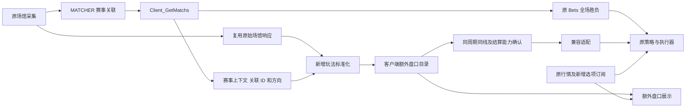

# 篮球其他盘口的客户端匹配方案

[changmen 扩展] 2026-10-30。状态：分阶段实施，首步 RAY 全场让分单馆展示已接入本地源码，跨馆匹配及新增盘口执行尚未实施。现有策略和篮球全场胜负链路保持。本文以当前工作区源码和已有调研为依据，本地实现不代表已发布上线。

## 1 方案结论

保留现有 `赛事采集 → MATCHER → Client_GetMatchs → 原策略和执行`。服务器继续决定赛事归属、统一主客队、场馆赛事 ID 和方向；现有全场胜负继续使用服务器下发的 Bets，不删除、不替换，也不增加登录时的等待。

新增部分为客户端的篮球其他盘口目录：复用场馆响应，识别让分、大小分等市场，按已匹配赛事和统一方向建立原生投注项映射。新增目录与原 Bets 分开存放、分开标识；符合相同结算含义和既有执行能力的盘口，后续通过适配接入原策略及执行流程。

**现有策略不改动，新增盘口的身份、数据接入和显示可以扩展。** 不重写套利公式，不改变用户的下注开关、金额、赔率条件、下注顺序、PM FOK/GTC、补单和订单确认规则。增加可识别盘口，不等于任意盘口都能立即套用原二元对冲模型。

不恢复此前已撤回的全量本地盘口试验脚本。最初方案阶段只编写文档；随后经用户确认，首步仅实现 RAY 全场让分展示，范围和接线见第 13 节，不部署 VPS。

## 2 保留和新增的边界

| 对象 | 处理方式 |
| --- | --- |
| 电竞全部既有盘口 | 原链路运行 |
| 篮球既有全场胜负 | 原服务器 Bets、采集白名单、价格和执行行为保留 |
| 篮球赛事关联及生命周期 | 继续以 MATCHER 的结果为准，不在客户端重新合场 |
| 主客队和场馆方向 | 直接消费服务器结果，不按盘口名重新判断，不增加方向覆盖按钮 |
| 篮球其他盘口 | 新增客户端目录和跨馆映射，只读取场馆原生数据生成 |
| 实时价格 | 复用原场馆行情和报价工具；新增选项需登记行情，不把结构快照当可成交报价 |
| 自动下注及手动下注 | 原入口和原开关保留；新增盘口通过明确的能力适配接入 |
| 账户、资金、订单、用户配置 | 沿用原归属及持久化规则；不能仅凭新增盘口有 ID 就绕过原预检 |
| OB 篮球 | 与现有 OB 接入方案分开推进，不把尚未实现的体育来源作为首期前提 |

范围判定使用 catalog 的篮球代码，包含现有电竞聚合通道中的 `basketball / GameID=10001`。该项当前标记为 `sport=esport`，不能仅用 sport 字段识别；先用 `resolveGameCode` 将“篮球”等显示名转为 `basketball`。独立体育页的 `nba` 与已有历史数据不顺带迁移。

原全场胜负由服务器拥有，客户端扩展不得再生成一份同义全场独赢。半场、单节胜负属于不同周期，后续可作为其他盘口单独接入。

## 3 当前基础和实际缺口

以下是源码现状，目录或调研存在不等于运行链路已经接入。

| 位置 | 可复用能力 | 尚需完成的部分 |
| --- | --- | --- |
| [RAY 原盘口读取](../client/packages/venue-browser/adapter/ray/markets.ts) | 单场 v2/odds 响应含原生盘口与投注项；新增展示模块在旧筛选之前旁路读取完整响应 | 原 `loadRayBets` 返回的 bets、matchResult 仍只包含旧胜负范围，不能据此重建全部其他盘口；当前旁路仅展示全场让分 |
| [RAY 旧解析](../client/packages/venue-browser/adapter/ray/shared/save_bets.ts) | 已有独赢分组、原生球队侧别、状态和 ID 处理 | 保持旧过滤器不变，新玩法不能通过放宽旧白名单混入原策略 |
| [RAY 分阶段规则](../packages/shared/catalog/venues/ray.ts)及[测试](../packages/shared/catalog/venues/ray.test.ts) | 已有篮球让分、总分、单队总分、半场、部分节次等定义；保留 stage、tag、value、全部选项和正负线；全场让分定义已被新增展示模块复用 | 原采集、合场和执行入口未切换；`groupRayOdds` 是原生分组器，不是不同分数线的配对器，结算兼容尚未认证 |
| [PM 采集解析](../server/collectors/polymarket-esports/parse.ts)及[索引](../server/collectors/polymarket-esports/market_index.ts) | 已有赛事身份、全场/地图胜负、token 与市场索引 | 当前索引不能当作篮球让分和大小分的完整目录 |
| [PM 浏览器行情](../client/packages/venue-browser/polymarket/markets/collect.ts)及[报价 hub](../client/packages/venue-browser/polymarket/marketQuoteHub.ts) | 可复用 token 报价、订阅、重连、买价和精度工具 | 新市场先需要完整 token/condition 身份，再登记独立的订阅消费范围，不能覆盖原 esport 订阅集合 |
| [套利选腿](../client/packages/arb-core/src/arbitrage/pickArbLegs.ts)及[建单](../client/web/src/domain/betting/buildOrderOptions.ts) | 原二元选腿、金额分配、平台顺序和配置 | 输入必须是结算互补的两个结果；现有 Home/Away 模型尚未表达周期、单双队目标和让分/总分结果含义 |
| [原策略过滤](../client/web/src/domain/betting/betFilters.ts)及[主循环](../client/web/src/stores/match/mainBetLoop.ts) | 初赔、上次赔率、次数、目标和补单维护 | 新盘口需要稳定身份及相应历史上下文；不能把临时缺盘当作可删除补单的依据 |
| [OB 篮球方案](OB_BASKETBALL_INTEGRATION_PLAN.md) | 已有体育协议、hpid、命名空间、行情和交易边界调研 | 尚未实施；体育协议不能落到原 OB 电竞下注 provider |

2026-10-27 的[篮球调研](audits/2026-10-27-basketball-markets/research.json)与[具体盘口样本](audits/2026-10-27-basketball-markets/hedge-lines.json)已记录 RAY/PM 同周期同线的结构交集，但不是可成交性或盈利证明。历史样本中的盘口数量与排名不作为本方案的新策略规则，不新增固定“七种盘口”或“七条盘口”的配额。

### 3.1 已有 RAY 定义可怎样复用

以下是当前 staged catalog 中的代表性定义，不是新加的生产白名单，也不是所有节次的完整覆盖。RAY 篮球原生 game ID 为 `1072082`。

| 原生 group ID | 原生 stage / tag | 本地标准语义 | 本方案处理 |
| --- | --- | --- | --- |
| `1279801` | `final` / 胜负 | 原全场胜负 | 继续由服务器 Bets 提供，不重复生成 |
| `1279840` | `final / hdp` | `full / spread` | 首批；按统一主队和精确让分线拆分 |
| `1280153` | `final / ou` | `full / total` | 首批；按精确总分线拆分 Over/Under |
| `2275879`、`2275779` | `1st / hdp`、`1st / ou` | `h1 / spread`、`h1 / total` | 后续周期扩展，不能与全场混配 |
| `1280447`、`1280625` | `q1 / hdp`、`q1 / ou` | `q1 / spread`、`q1 / total` | 后续周期扩展，不能推定其他节次同样已覆盖 |
| `18478287`、`18478621` | `final / ou`，目标 team1 / team2 | `full / team_total` | 先按服务器方向统一目标球队，再按线配对 |

规则表定义“如何理解一种盘口”，运行时读取该场比赛实际存在的盘口、选项及状态。`betId / odds_id / homeId / awayId / tokenId` 不能从 group ID 推算，也不能预先写死成一张全局映射表。静态规则可复用，单场原生 ID 仍须来自场馆响应；PM 对侧按同一标准语义建立动态绑定。

## 4 数据流



`legacyBets` 和 `extraMarkets` 具有独立所有者。显示层可以组合两者，不能执行 `match.bets = localBets`、清空服务器 Bets，或全局拦截赛事响应后替换全部盘口。原对象和下注方法不做运行时 monkey patch。

新模块的错误只影响对应新增市场。缺新盘口、缺报价、网络失败和扩展停止，不清理原行情，不重启原采集器，不停止原主循环，不改写服务器 Matchs 或赛事结束状态。

## 5 新增盘口范围和顺序

| 阶段 | 玩法和周期 | 接入条件 |
| --- | --- | --- |
| 首批 | 全场让分、全场大小分 | RAY 与 PM 有同周期、同线、明确规则的原生双向市场；优先完成常见半分线 |
| 第二批 | 半场让分、半场大小分 | 明确 H1/H2 的计分范围；有真实字段及结算依据 |
| 第二批 | 单节让分、单节大小分 | Q1–Q4 分开，不将节次压成电竞 Map 数字 |
| 后续 | 单队总分，含全场及已验证的半场/单节 | 统一球队身份、周期和总分范围均一致 |
| 后续 | 半场/单节胜负 | 明确是否允许平局，以及平局时两馆如何结算；不得直接当作无平局独赢 |
| 待单列 | 整数线、四分之一线及复合线 | 补齐走盘、半赢半输等结果模型后才能决定是否适用原策略 |
| 本轮不做 | 冠军、球员、比分、跨线中间盘等 | 不能由同场赛事和相近盘口名称推导互补；另行设计，不改变当前策略 |

阶段表示实施顺序，不固定挑选盘口数量。一个原生盘口组可能有多条让分线，每条线都是不同市场，必须分别匹配和保存。

## 6 原始数据接入和请求复用

### 6.1 RAY

首选在原 `v2/odds` 成功响应到达、进入旧独赢过滤器之前，提供一个只读原始快照订阅点。新模块从完整 payload 读取其他盘口；原 `loadRayBets` 返回值、旧 fo 写入、SaveMatch/SaveBet 和采集周期保持原行为。订阅者抛错不能阻断原函数。

这需要一个明确的小型接线点，不意味着采集策略或白名单改变。不能只订阅 `collectStore.saveBets`：其中没有原解析器已经筛掉的其他玩法，也不能从 `matchResult` 恢复被裁剪的 value、tag 和全部选项。

如果原始响应尚未有可复用入口，新增模块可经现有公开 `collectRayGet` 按服务器已关联的 RAY 赛事 ID 定向读取完整 odds。该请求由同一个按赛事去重的请求层管理，不重新请求赛事列表，不复制采集凭证，不启动第二套全表采集器。实施时统计这部分新增请求，不能声称仅新增脚本就天然零请求开销。

不能为了读取让分和大小分而用更宽正则反复调用旧 `loadRayBets`；其写入 fo 和结果处理也会跟着改变，容易污染原链路。

### 6.2 PM

先复用已存在的完整 Gamma 赛事/市场响应缓存；若客户端没有该缓存，再通过既有 PM transport、按 Matchs.Polymarket 中已关联的事件标识请求该事件的市场数据。这里不能假定 SourceMatchID 总是数字 event ID：现有解析器还允许 slug，少数回退值可能是 market ID。按明确的原生标识类型解析其所属事件，并校验返回的关联关系；不能凭队名另找一场。保留 marketId、conditionId、tokenId、原生 outcome、类型、周期、分数线、状态和规则引用。

这是针对已知赛事的市场读取，不在浏览器重新发现联赛、建立赛事身份或恢复第二套电竞 discovery；不得从客户端导入 VPS parser。现有胜负 MarketIndex 不扩写为让分盘，也不把不完整索引当作完整 Gamma 数据。

如果既有 transport 在目标环境不能完成这项只读请求，先记录为该环境的数据接入缺口。后续可使用已有只读 relay；若必须新增服务端传输接口，单列增量契约与流量预算，服务器只传输必要原生数据，匹配仍在客户端，不借机改造 matcher。

新 token 使用既有报价工具，单独登记订阅消费范围。不要复用并覆盖当前固定的 esport consumer；若当前 consumer 类型集合不支持新增订阅所有者，明确补齐这个接入点。停止扩展仅释放自身资产引用。

### 6.3 冷启动和缓存

登录后原盘口按原速度显示；新增区域按单场、单馆渐进出现，不等待所有场馆和所有赛事完成。优先使用当前会话已有快照，只有缺失或明确需要刷新时才补查，多个消费者共享在途请求。

首期使用内存目录即可。持久化缓存只作为后续启动优化：可保存规则版本和非敏感原生结构，重新核对赛事绑定和当前状态后使用；缓存赔率不能直接作为执行报价，不存凭证或已准备订单。不要先引入数据库或额外服务来解决尚未测量的冷启动成本。

### 6.4 更新、失效和乱序

每次更新标记用户会话、场馆、源赛事、请求代次及覆盖范围，区分完整快照和局部增量。完整快照只替换它明确覆盖的目录；局部更新不能清空同赛事的其他玩法。网络失败、解析失败和未确认含义的空响应不等于全场撤盘，应保留结构并显示当前数据状态，执行仍遵守原行情有效性与预检规则。

原生明确锁盘、关闭或完整有效快照确认某来源消失时，停止将该来源用于新候选；不据此删除原全场胜负或未完成订单。解锁后按当前原生身份恢复，不自动延用已换代的 bet/token ID。赛事结束和重新关联仍跟随服务器结果。

登出、切换账号、赛事重新绑定后，旧请求返回即丢弃。并发请求只允许当前代次发布；有原生版本时在同一来源内比较，不能把不同平台的时间戳当统一版本。结构快照与实时行情分开更新，晚到的 HTTP 响应不能用其附带旧赔率覆盖较新的 WS 行情。遇到无法判断先后的结构冲突，重新确认来源后再形成新候选，不靠“最后到达”认定有效。

## 7 盘口身份和标准化

### 7.1 匹配身份

每个新增市场的逻辑身份采用稳定字符串，至少包含：

```text
clientMatchId
sport = basketball
period = full | h1 | h2 | q1 | q2 | q3 | q4 | ot:序号
marketCode = spread | total | team_total | period_winner
target = match | canonicalHome | canonicalAway
line = 规范化的十进制字符串或 null
lineBasis = canonical_home_adjustment | total_points | team_points | none
scoreBasis = whole_period | remaining_from_score
scoreAnchor = null | 统一方向的起始比分
overtimeRule = included | excluded | not_applicable | unknown
settlementProfileId
```

按上述语义生成 `marketKey`；规则版本、赛事绑定版本和原生盘口/选项版本作为记录的独立元数据。行情变化不改变逻辑身份，原生 ID 换代改变绑定版本。未知结算信息可以保留展示，但不能作为已经兼容的结算 profile。

分数线保留原始文本并做严格十进制归一化，如 `+4.50 → 4.5`、`-0 → 0`。拒绝 `parseFloat` 截断未知格式，不对让分线取绝对值；四分之一线和复合线保留原始分量，不能取平均后伪装成已支持的普通单线。

RAY 原生 group key 与客户端 marketKey 分开：同一个 group ID 可以包含多条线，必须继续按 value、选项球队及市场语义拆分。原始 value 中带比分上下文时，先判定该玩法是整段计分还是余下计分；后者保留起始比分，二者不能互配。

### 7.2 场馆绑定

每条来源绑定保存：provider、sourceEventId、nativeMarketId、groupId、conditionId/hid 等协议字段，以及每个选项的原生 ID、语义、原始方向/分数线、状态、结构版本和报价引用。长 ID 全程字符串保存。

所有来源必须属于该 `clientMatchId` 已下发的 Matchs。不按队名猜另一场比赛，不自行扩大 sibling event 集合。赛事重新关联、方向变化、删除或规则版本变化时，废弃对应旧绑定，保留仍在处理的订单所固定的引用。

### 7.3 方向和选项含义

直接使用现有 DTO 的 `Reverse` / ViewMatch.reverse 和 Matchs 场馆绑定，不新增主客队推断流程或方向字段。让分统一以服务器主队为参照。例如统一主队 A 的线为 `-4.5`，对侧为 B `+4.5`。源站若将 B 放在原生主队位置，按服务器方向转换一次，主队参照线相应换号；不能交换后再次翻号。

大小分的两个结果是 Over/Under，反向赛事不交换它们；单队总分的 target 则必须随服务器球队方向转换。不得将所有市场统一执行“反向就交换 HomeID/AwayID”。

本地模型使用结果语义，如 `home_cover/away_cover`、`over/under`。只有接入原二元接口时才将其投影为技术槽位 Home/Away；此时槽位不再天然代表两支球队。界面、操盘目标、订单名及补单标签都要携带真实结果含义。

## 8 跨馆匹配规则

同一赛事内，只有周期、玩法、目标、分数线、计分范围及结算 profile 一致的市场才可组成同一标准市场；选项互补还需逐项确认。不能仅按 `betId` 或中文标题相似度匹配。

| 来源组合 | 处理 |
| --- | --- |
| A -4.5 与 B +4.5，同周期同规则 | 可进入互补关系验证 |
| A -4.5 与 B +5.5 | 不按原双腿互补策略配对；跨线另属策略变更 |
| 全场总分 220.5 与上半场总分 110.5 | 不匹配 |
| 总分 Over 220.5 与 Under 220.5，同规则 | 可进入互补关系验证 |
| 同一分数线、不同球队的单队总分 | 不匹配 |
| 同名全场盘，一馆含加时、一馆仅常规时间 | 不匹配 |
| 半场胜负平局一馆退款，另一馆分摊结算 | 不能假设为原二元互补 |
| 一馆明确暂停，另一馆仍显示旧价 | 保留结构，仅使用满足原行情及执行条件的来源 |

加时标题只能作为语义证据之一。中断、取消、延期、平局和更正等条款仍属于 settlement profile 的内容；现有 RAY 分阶段规则明确标记 `settlement.verified=false`，不能因盘口代码已存在就宣布结算等价。

对于总分均为整数的正常计分，半分阈值没有刚好等于该阈值的结果，适合作为首批严格二元模型验证输入；这不替代周期和取消规则核对。整数线可能走盘，复合线可能部分退回，不能只验证 `1/赔率A + 1/赔率B` 就沿用原利润含义。

## 9 保持现有策略的接入方式

### 9.1 展示和检测

新增 `extraMarketStore` 与篮球额外盘口组件。原比赛卡和原 Bets 保留，额外区域显示玩法、周期、线、选项、场馆价格及缺失原因。单馆也可展示，但跨馆组合仍遵守原策略的场馆条件；不制造第二条腿，也不增加暂停原主循环的限制。

完成语义确认的二元市场可投影给原纯检测函数做监听对照。该对照不改变原配置，不另发明收益率公式，也不把调研中的毛收益排序替换用户原策略。

### 9.2 执行与订单

后续接入遵循“同一执行器、同一资金调度、同一用户下注开关”。不能为新增盘口启动另一套同时下单的套利循环；普通入口和现有 listener 入口应消费同一个新增目录及兼容适配，不改变各自已确定的调度含义。

新增机会会与原机会共用账户余额和原有执行锁，因此启用后可能影响可用余额及实际成交数量。这属于新增输入参与既有调度的结果，不能承诺旧单成交次数逐笔不变；也不为此私自加入新盘口优先级、独立资金池或新的下注策略。

必须明确以下接线工作，完成后再将新盘口作为原策略的可执行输入：

1. **业务身份**：原 BetRow/ViewBet 的 ID 与过滤、订单、补单存在数字 ID 约束。新增市场先用独立 marketKey；不得按 Map 编号或 32 位 hash 硬塞，不能与全场胜负共用业务 ID。执行接入时补齐可持久化的市场身份及兼容映射；若现有订单契约不能表达，明确增加契约及必要存储支持，不承诺“仅加前端目录就能完成下单”。
2. **账号过滤**：金额、次数、操盘目标、初赔及上笔赔率都要以新增市场的真实身份索引。原全场初赔不能作为让分或大小分初赔；也不能填 0 后利用“缺失即通过”悄悄略过用户已有约束。缺少相同定义的必要输入时，该盘口对相应策略能力不就绪，原盘口不受影响。
3. **报价和选腿**：保持原平台筛选、赔率条件、注码分配和顺序；PM 使用实际可买报价、原深度/价格缓冲和 FOK/GTC 约束，不用页面最后成交价或互补概率代替可成交价。
4. **胜率类输入**：全场球队胜率不能当作让分、总分或某节结果的胜率。依赖这些输入的 C、EV、WinRate、单边能力要逐项核对数据语义，不自动更换用户策略，也不伪造胜率。
5. **场馆原生引用**：RAY 复用原预检/提交并传真实 odds_id/value/stage；PM 传真实 market/condition/token，不能将同赛事另一分数线的 token 当作替代项。是否支持新市场由真实预检和协议能力确认，不能仅从方法签名推断。
6. **绑定稳定性**：一次尝试固定来源 ID、线、周期及结构版本；确认前和提交前仍须满足原生绑定。换盘后重新准备，不能在已准备订单上原地换为另一条线。
7. **订单和补单**：记录周期、玩法、目标、分数线和协议身份。断流或临时撤盘不删除未完成订单；禁止原主循环仅按 legacy bets ID 的清理逻辑清掉新增盘口的待处理单。新增盘口单的合法身份集合及终态清理应与订单生命周期共同维护。

以上是让新增市场正确表达原策略输入的必要适配，不扩展策略本身。若需要改阈值、做跨线对冲、改变走盘收益计算或另建交易规则，应拆成独立策略变更，不混入本方案。

## 10 模块划分和回滚

建议一个篮球额外盘口入口模块，内部按职责拆为纯规则、原生数据接入、本地目录和兼容适配。不要把所有场馆协议、行情与交易都塞进一个难以验证的大脚本。

| 归属 | 拟新增或最小接入内容 |
| --- | --- |
| `packages/shared/catalog/venues/` | 原生规则及标准化纯函数，复用当前 RAY staged 文件；增加 PM 其他玩法的明确解析规则 |
| `client/packages/venue-browser/` | 原始快照只读订阅、已关联事件的市场读取、选项报价订阅；通过公开入口交付 |
| `client/web/` | 额外盘口目录、展示和对原策略输入的兼容接入；原策略实现保留 |
| `client/packages/client-core`、`packages/api-contract` | 执行阶段所需的结果语义、市场身份和订单上下文；仅在确定契约缺口后定向补充 |
| 现有 listener 模块 | 后续实现时按其实际共享入口验证，不为本方案另建一套策略和账户会话 |

客户端不能引用 `packages/match-identity` 或 server/match、backend、DB 的实现，也不恢复已退役的 shared/match-identity 入口。所需赛事绑定来自既有 DTO，盘口纯函数归真正双端共享规则或浏览器包。

新增入口可独立启停，其开关仅控制额外盘口功能，不覆盖原下注开关。关闭时停止新请求和订阅、移除额外区域，原 Bets 和原主循环持续运行。存在新盘口未完成订单时，只停止新开仓，保留原订单观察与补单所需的固定上下文，不能简单销毁目录后遗失订单。

不要求本次方案修改后端匹配、采集写库或生产部署。执行阶段如确认需要兼容订单字段或只读传输能力，应明确单列最小修改和回滚顺序，不能以“策略不变”为由隐去这些工程依赖。

## 11 实施阶段与验收

| 阶段 | 交付 | 验收重点 |
| --- | --- | --- |
| A 原始快照与规则 | RAY/PM 已关联赛事的完整只读结构、标准化和录制样本 | 中文游戏名、加时名称、正负线、多个备用线及原始 ID 保留；旧采集返回和写入结果不变 |
| B 客户端匹配与展示 | 全场让分、全场大小分的独立目录与界面 | 原 Bets 前后完全一致；新盘口逐场出现；单侧缺盘、空响应、断流和换盘有明确原因 |
| C 原检测监听对照 | 同线同规则二元市场接入原纯检测 | 对同一已匹配输入，原检测结果一致；不增加策略排名、固定数量或新资金逻辑 |
| D 原执行链路接入 | 身份、过滤、原生预检、订单与补单的最小兼容适配 | 所有入口使用原开关和执行器；新市场身份不碰撞；不会误发另一条线或清理待处理订单 |
| E 范围扩展 | 半场、单节、单队总分，随后按 OB 实际接入情况扩馆 | 逐周期、逐场馆验证规则和执行能力；旧全场及电竞回归不变 |

阶段是验证顺序，不新增业务上的手动审批或账户限制。代码检查、预检、真实提交分别按其正常授权与发布流程执行，本次文档工作不执行真实下注。

必要测试包括：主客反向的让分换号、Over/Under 不随球队反向、单队 target 反向、中文“篮球”识别、包含加时的名称、同组多条线、缺边、未知 group、相邻周期误配、整数/复合线排除、PM token 顺序和结果含义、旧 HTTP 晚于新 WS、登出后旧响应、ID 换代，以及原盘口、未完成订单和 listener 的兼容。

原策略差分使用相同赛事、配置、账户和报价输入：关闭新增模块时，原盘口数量、ID、价格订阅、检测、过滤、顺序、注码及订单引用应与基线一致；启用后原盘口仍一致，差异只能来自明确标记的新增市场。

实现时按实际改动使用 `check:change:plan` 和 `check:change`，前端构建包含类型检查；涉及共享执行或 PM 下单时覆盖对应 FOK/GTC，涉及订单字段再覆盖相应数据兼容。单纯本文和文档索引不执行业务全量检查，不修改冻结基线或历史审计哈希。

## 12 优化后的实施决策

| 原始设计中容易出现的问题 | 采用的优化 |
| --- | --- |
| 新功能重建全量 Bets，导致旧盘口消失 | 原 Bets 完全保留，只增加 extraMarkets |
| 每次登录重新拉全场馆 | 复用原始响应；只按已关联 event ID 补缺，进行中请求合并；旧盘不等待 |
| 已有原解析结果就被当成全玩法数据 | 在旧白名单之前取得 payload，保持旧策略输出不变 |
| 为新玩法再启动整套策略循环 | 接入原执行器和原资金调度，纯监听只是前期验证形态 |
| 将大分/小分硬标成主队/客队 | 独立保存结果语义，技术槽位适配时带完整标签 |
| 相同 group ID 的所有分数线混成一盘 | 原生分组后继续按精确线及目标拆分 |
| 一开始覆盖全部玩法和场馆 | 先 RAY/PM 全场让分及大小分，再按已验证数据扩周期和场馆 |
| 只统计命中数量就判断更好 | 同时记录数据开销、可映射覆盖、同规则覆盖、可报价状态及原链路差分 |

性能验证区分三种时间：原始结构到达本机、客户端映射发布、新盘口被原检测消费。只有前两项改善才归因于本地匹配；不声称实时价格因此天然更快。HTTP、WS 订阅数、重解析次数和原列表首屏时间同时记录，报价变化仅更新依赖的新增市场，不触发全表重新解析。

目标是让篮球其他盘口无需等待服务器新增玩法合盘即可建立本地映射，同时维持现有全场胜负和原策略的行为。首期优先证明这一点，再决定是否需要持久化缓存、扩大周期或调整原始数据传输。

## 13 首步实现：RAY 全场让分单馆展示

用户确认的本步范围是：只展示 RAY 篮球全场让分，紧接原全场胜负，不做跨馆匹配，也不接入新增盘口下单。整数线及复合线可原样显示，不受未来执行阶段二元能力范围限制。

| 模块或接线 | 当前职责 |
| --- | --- |
| [basketballSpreads.ts](../client/packages/venue-browser/adapter/ray/basketballSpreads.ts) | 新增独立数据模块；复用 catalog，按原生球队及带符号分数线整理；缓存最多 128 场快照；给新增 odds_id 登记报价，使原 WS 更新逻辑直接复用 |
| [RayBasketballSpreads.vue](../client/web/src/components/match/RayBasketballSpreads.vue) | 新增展示组件；显示统一双方名称、让分、报价和锁盘；不绑定下注、操盘目标、EV 或补单事件 |
| [markets.ts](../client/packages/venue-browser/adapter/ray/markets.ts) | 原始 odds 响应的唯一数据接线，兼作现有公开出口；原请求、胜负筛选、返回和上报保持 |
| [MatchCard.vue](../client/web/src/components/match/MatchCard.vue) | 唯一界面接线，在篮球已有全场胜负后挂载组件；不修改 match.bets |

每条具体分数线是一个独立盘口，分别生成卡片，标题写明双方分数线，例如“[全场] 让分（主 -4.5 / 客 +4.5，含加时）”。“全场让分”只是玩法分类，不生成分类总卡片；没有具体线、快照未到或有效快照为空时不生成盘口卡片。缺侧显示缺项，删除状态不展示。服务器 Reverse 只用于交换现成原生选项，不再翻转其让分符号。报价从原 fo 读取，不以缓存的结构初值兜底；HTTP 请求在途期间到达的较新 WS 报价不被该 HTTP 初值覆盖。展示模块内部捕获异常，原胜负解析照常执行。

本步不增加 HTTP 请求或 WS 连接，也不扩大原采集的第一页、一小时开赛窗口及轮询范围。服务器已有比赛但本机尚无其 RAY odds 时，原胜负继续显示；待取得具体分数线后增量显示对应卡片，不把网络失败解释为撤盘。

维护新玩法时优先修改这两个新增模块及其测试；无需改原策略。撤回时移除上述两个接线和新增模块，并同步自动生成的组件类型声明即可；不回滚原 catalog 或工作区中其他任务的改动。新增报价条目沿用原缓存过期清理，不清空 RAY 原胜负报价。

2026-10-30 本地验证：新增模块及展示共 9 项专项测试通过；前端回归 600 个文件、6468 项测试通过（另有 3 个文件、4 项跳过）；`test:checks`、前端类型检查和 `app:build` 通过。验证覆盖原胜负输出、服务器方向、多条线、缺侧、删盘、锁盘、原 WS 更新、HTTP 晚到及展示异常隔离；未执行真实下注或 VPS 发布，未将历史样本当作当前场馆在线验收。

同日按用户反馈修正卡片语义：移除无具体分数线的分类占位卡，每张实际卡片在标题标明双方让分。展示回归共 4 项通过，包含三条分数线对应三张独立卡片及各自选项/赔率的验证；完整前端回归 600 个文件、6469 项测试通过（另有 3 个文件、4 项跳过），`test:checks` 及含类型检查的 `app:build` 通过。
