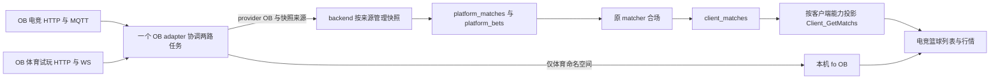

# OB 篮球接入方案

[changmen 扩展] 2026-10-29。状态：方案及源码审计完成，尚未实施。篮球继续归属电竞分类 `basketball / GameID=10001`，平台仍为 `OB`；采集使用 OB 体育官方试玩。独立体育篮球产品线退役。本文不表示接入、发布或真实交易已验收。

## 目标与范围

在现有 RAY 与 PM 篮球合场中增加 OB 全场独赢来源，沿用电竞 `platform_matches → matcher → client_matches → Client_GetMatchs`。首期接通采集、身份、盘口、行情和比赛生命周期；交易另有完整验收阶段。体育足球及其跟单能力继续运行。

用户已明确：篮球只保留电竞分类；原 `/sports/basketball` 及其专用读取链路可以移除。OB 体育作为协议和数据源保留，不再为篮球维护第二套产品入口。

当前篮球至少两馆才创建新合场，队伍映射、朝向锁和历史比赛 ID 继续由原 matcher 管理；不新增单馆成场或模糊匹配例外。RAY 和 PM 的既有盘口、发现窗口、FOK/GTC 执行规则不借本次修改重构。

相关入口：[现有 RAY 与 PM 方案](RAY_PM_BASKETBALL_PHASE1_PLAN.md)、[审计报告](audits/OB_BASKETBALL_INTEGRATION_AUDIT_20261029.md)、[当前目录布局](WORKSPACE_LAYOUT.md)、[团队边界](TEAM_BOUNDARIES.md)。当前物理数据层为 `rds/`，公共入口仍是 `@changmen/db`；不得按历史文档重新创建 `server/db/`。

## 已验证的体育协议

以下为 2026-10-29 官方试玩响应与前端代码证据，不属于 A8 parity 结论。经筛选的样本见 [upstream_samples.json](audits/2026-10-29-ob-basketball/upstream_samples.json)。

| 用途 | 当前入口或值 |
| --- | --- |
| 英文试玩登录 | `https://api.dbsporxxxw1box.com/yewu6/user/tryPlay?lang=en&terminal=PC` |
| 官方壳 | `https://user-pc-new.dbgaming.com/` |
| 本次官网版本 | `2026-10-10-16-14-47` |
| 运动 | `csid=2` |
| 滚球、今日、早盘 | `euid=30003 / 3020102 / 3020202` |
| 赛程 | `POST /yewu11/v2/w/structureTournamentMatchesPB` |
| 按比赛批量底价与名称 | `POST /yewu11/v1/w/structureMatchBaseInfoByMidsPB` |
| 单场详情和完整玩法 | `POST /yewu11/v1/w/getMatchBaseInfoByOddsPB` |
| 全场独赢 | `hpid=37`，`ot=1/2` 对应源站主客 |
| 其他全场主盘 | `hpid=39` 让分，`38` 总分；首期不采 |
| 推送 | `wss://{gateway}/yewuws2/push?requestId={token}` |
| 心跳与订阅 | C0 每 15 秒；C8 按原始数字 mid 及 hpid 订阅 |

实拉取得 NBA 和澳洲 NBL 的双向独赢盘口。今日菜单返回 5 条滚球、86 条未开赛赛程记录，早盘返回 169 条；这些是采样时记录数，不等于运行时采集范围或当前场次数。今日菜单还含 `NBA - Fantasy Matches`，不能将全部 `csid=2` 行当作真实比赛。

25 秒 WS 采样使用 localhost Origin、7 个 mid 和 `37,38,39`，收到 C105 3 条、C102 12 条、C103 10 条及 C303 1 条。C105 中独赢 37 均为锁盘，开放报价样本来自让分 39；因此已证明独赢锁盘推送，尚未证明开放独赢连续变价与长期重连。另收到不在目标篮球集合中的足球 C109，消费端必须过滤 mid 和运动。

HTTP PB 数据是 envelope 中的 base64 JSON，采样使用 gzip；WS C105 此次也为 gzip。现有解码器兼容 gzip、zlib 和部分 raw deflate，可提取复用，但不能仅按旧文档将 C105 写死为 zlib。

源站 NBA 与 NBL 全场盘在官方一般规则下包含加时，个别赛事说明优先。规则还对中断、3x3、友谊赛平局等作单独约定，不能把“包含加时”当作跨平台结算完全等价的证明。参考 [官方规则](https://sandbox-topic.dbsporxxxw1box.com/sports-rules/23-as/common/) 与 [官网前端](https://user-pc-new.dbgaming.com/2026-10-10-16-14-47/static/js/index-BpmuHnYR.js)。

## 接入架构



`OB` 继续表示品牌，不再隐含“必然是电竞协议”。一个 `obAdapter` 负责两路任务的启动和停止，电竞与篮球的请求、失败、限流和 WS 重连各自独立；体育 API 失败不得阻断原电竞轮询。registry 仍只注册一次 OB，不增加 `OBSport` 平台枚举。

venue manifest 仍属于浏览器采集，不标记 `vps_http_ws`，否则现有 Save* 门控会拒绝两路上报。采集说明及连接状态应能区分电竞 MQTT 与体育 WS，不能用同一个“OB 已连接”状态掩盖一路故障。会话沿用现有 Cookie/CSRF 的 backend 访问规则；新增 scope 不改变接口授权。体育试玩会话独立注入本机任务，不复制到下注凭证、ACCOUNT 或 RDS。

浏览器实现归 `client/packages/venue-browser/adapter/ob/`。体育协议纯解码、ID 编解码和传输能力抽到该包或纯共享模块，web 经公开 exports 使用；adapter 不得反向导入 `client/web/src/runtime/obSport*.ts`。宿主会话读取和状态展示通过现有 bridge/ports 注入。足球原有行为的迁移必须有兼容回归，不以大范围复制实现解决依赖方向。

## 身份与 DTO

以下为拟新增契约；现有源码尚未实现这些前缀。

| 项目 | 电竞 OB | 体育篮球 OB |
| --- | --- | --- |
| provider 与 Type | `OB` | `OB` |
| SourceGameID 与 Teams GameID | 原始电竞 game_id | `sport:2` |
| SourceMatchID | 原电竞 ID | `sport:{mid}` |
| HomeID、AwayID、Teams TeamID | 原电竞球队 ID | `sport:{mhid}`、`sport:{maid}` |
| SourceBetID 与 Sources BetID | 原电竞 market ID | `sport:37:{hid}` |
| SourceHomeID 与 SourceAwayID | 原电竞 odd ID | `sport:{oid}` |
| Map、BO、Round | 原规则 | 首期均为 0；节次单独保存，不借用地图 |

在 `game_catalog.json` 的既有 `basketball.platforms` 增加 `OB: "sport:2"`，归属及客户端类别仍是 `sport=esport / 10001`。不把篮球 37 填进电竞 `odd_type_id` 配置，也不将体育登录信息写进 `platforms.json`。

共享 ID helper 必须严格识别体育前缀、只去掉一次、验证后返回原始十进制字符串；不使用随意 `split(':')` 取末段或对 18 位 hid/oid 调用 Number。SourceBetID 同时保存 hpid 和盘实例 hid，可用于存储后重建盘口身份；原始 mid/oid 可逆，不依赖仅存在采集机器上的元数据缓存。

比赛上报保留真实 `mgt` 毫秒开赛时间、英文 `mhn/man`、源站球队 ID 和 Teams。赛程袋只能用于发现 mid，不能用袋的联赛时间替代逐场时间，不能沿用足球 DTO 的占位标题或时间钳制。缺真实队伍名或时间时先补底价/详情；仍不完整的行记录原因，不参与合场。

命名空间球队 ID 进入 `team_venue_maps` 的 OB 索引，按现有人工关联流程与 RAY/PM canonical 队伍建立关系。不得将原体育 `nba` 队伍或比赛行直接改名复用，也不自动创建未经验证的队伍关联。

## SaveMatch 的来源边界

仅在一个浏览器里拼接 `电竞列表 + 篮球列表` 可以解释数据形状，但不足以支持旧客户端、不同采集机器和独立发布。生产方案保留 action `API_SaveMatch?OB` 与 `provider=OB`，新增可选表单字段 `snapshotScope`，由服务端合成为唯一 OB 视图。

| 请求 | 来源范围 | 成功更新的内容 |
| --- | --- | --- |
| 旧 OB 请求，未带 scope | `esport` | 原电竞 OB 子集 |
| 新请求 `snapshotScope=esport` | `esport` | 同上 |
| 新请求 `snapshotScope=sport-basketball` | `sport-basketball` | 只更新 `sport:2` 篮球子集 |

新篮球请求示意，`matchs` 仍是 JSON 字符串：

```text
action = API_SaveMatch?OB
provider = OB
snapshotScope = sport-basketball
matchs = [{ Type: "OB", SourceGameID: "sport:2", SourceMatchID: "sport:5796454", ... }]
```

`SaveMatchRequest`、web API、collect bridge、router 和 DB 入口均须显式承接该字段；当前 zod schema 会剥掉未知字段，不能只在调用端追加参数。缺省 scope 只兼容原电竞，拒绝带体育前缀的混合列表；显式 scope 与行内 game/ID 不一致时拒绝整批，不能静默裁剪后触发孤儿清理。其他 provider 保持原有契约。

两路各自在成功完成自身发现后提交自身快照；前端不得周期性重发另一来源的缓存。服务端内存、盘口孤儿清理、RDS 缺席比赛和 timer 清理都按同一来源边界执行，合场读取的是两路的并集。旧电竞请求不能保活、删除或重置篮球的缺席时钟。

RDS 排队键由 `collector:OB:matches` 扩展到 scope 维度，避免两路待写任务 coalesce 覆盖。SQL 的 orphan 条件不能只按 platform=OB；分区判断必须使用同一纯规则，并覆盖 history 迁移、alsoKeep、重启恢复和空列表。其他平台及电竞空列表 sticky 规则保持原行为。成功空篮球快照采用现有五分钟缺席宽限，超过宽限由独立清理检查收敛；HTTP 失败不冒充成功空列表。不能依赖另一来源非空上报来触发清理。

不要求新增平台或为 ID 字符串修改列类型。scope 可由持久化的 source_game_id 和命名空间重建，但来源清理行为属于 DB 数据契约变更，需 PostgreSQL 回归。每个 scope 维持一个明确的上报者；若部署要求同 scope 多写者，则需先补写者归属/排序设计，不能认为 scope 自带防竞争能力。

`API_SaveBet?OB` 继续按 `sport:{mid}` 单场替换，不另建品牌。`API_SaveLiveTimer?OB` 继续只承载电竞地图计时；现有实现会扫描 OB 全部 IsLive，必须过滤体育行，篮球不伪造 Q1 为 Round=1。

## 盘口与本机行情

首期严格选取真实篮球、hpid=37、全场、双向 `ot=1/2` 且无第三项的市场。不是只靠中文“独赢”名称或盘口条目数量判定；选项按 ot 对齐，禁止按数组顺序决定主客。收盘、锁盘及缺项保留已知 ID，明确上报 Locked，不能用空 bets 表示撤盘，因为当前空 SaveBet 会保留旧盘口。

matcher `native_bets` 增加体育篮球明确判定：gameCode=basketball、Map=0、来源为体育、SourceBetID 可解析成 hpid=37。不要靠改成“获胜”名称绕过电竞正则，更不能给所有 OB 盘口放宽白名单。现有五款电竞的 odd_type_id 与名称回退均保持。

体育 WS 使用原始数字 mid 与 `hpid=37`。底层 C8 builder 虽支持 hpids 参数，现有连接器内部调用仍使用足球默认值，因此需要将订阅规格贯穿到 transport 实例。足球和篮球使用独立 session/WS 实例及独立状态键，防止 C8 覆盖订阅集合或状态互相覆盖。

HTTP 底价和 C105 都转成同一带前缀的 oid/betId，通过现有 odds bridge 写 `fo[OB]`。每个查看篮球的客户端都必须启动自己的体育行情和缺盘补查，不依赖开启 CollectConfig，也不依赖采集端的 localStorage 或元数据 Map。GetMatchs Sources.HomeOdds/AwayOdds 不能代替 fo；现有 OB ViewBetItem 不将它们当可用行情回退。

体育适配器局部负责 HTTP/WS 先后顺序和代际：较晚完成的旧 HTTP 不得解开已收到的新 WS 锁盘；会话更新、重连、hid/oid 换代必须废弃旧代报价。不要修改全平台 oddsStore 的覆盖语义来修一馆。

锁盘使用 `hl.hs`、`ol.os` 联合判定；`hs=2` 即使 ol 还带旧价格也锁。C104/C109 等场级状态只处理目标比赛，缺失 ms 不转成未开赛；C303 单场合并节流补查，不全表抖动。压缩解码失败、WS 断开、明确的无效/撤盘状态使该体育报价失效，恢复需新一代底价/订阅确认。安静无变价并不证明断线，不使用“若干秒无 C105”单独判断过期；依靠连接/心跳与结构校验，并在实现前通过持续采样定出最大结构年龄。

清理只能操作 OB 体育子集，禁止 `clean("OB")` 清掉原电竞赔率。停止、登出、HMR 和来源失效必须一并停止定时器、WS、请求回调并移除旧体育索引。

## 篮球状态和比赛生命周期

体育 `ms=0/1` 不能原样当成电竞 `IsLive=1/2`。拟定义篮球转换：明确未开赛→IsLive=1，明确进行中→2，经正式状态表证实的终态→3，未知不填。IsLive=3 是本次扩展值，现有生命周期不会自动识别，需定向分支及契约测试。

采样篮球当前比分使用 `msc.S1`，半场为 S2/S3，单节为 S19–S22；不能照用只读 S0 的足球解析。时钟按节次、启动/暂停事件和联赛时长解释，未核实字段时保留未知，不从开赛时间或比分推导结束。

有 PM 来源时继续遵守当前 PM 明确终态与身份一致性规则；首期不改变整场终态仲裁优先级。无 PM 的 OB+RAY 篮球需要消费经证实的 OB 终态，解决 Round=0、仅全场盘且永远不结束的问题。赛程消失、独赢锁盘和 Q4 本身均不是终态。未知终态映射及延迟场次是持续取样必验项。

身份为既有篮球时不走 BO 决胜局剥盘；不会把 PM 全场盘移到 Q4。比分若增加持久化或广播字段，需扩展 DTO/DB/outbound 全链；首期不宣称已有 OB 比分展示，仍可沿用 PM 现有比分。

## 交易阶段的完整边界

采集试玩凭证不用于真实下注。现有 OB 体育账号凭证位于 `sportOb`，体育钱包是 `sportBalance`；它们与电竞 `token/balance` 分离。已有 `Client_SaveSportAccount` 保护继续使用，不能把体育 token 写进 ACCOUNT 的电竞 token，也不改变 ACCOUNT 加载/保存时序。

第一阶段 OB 体育来源只提供展示/监听。新客户端需要在可执行腿选择、账号选号、checkBet、betting、重试及补单共同检查来源协议能力；尚未实现的协议必须返回清晰的不支持结果且清空 prepared data，任何入口都不得回落到电竞 `/game/bet`。该限制仅适用于新增体育协议，RAY/PM 既有篮球执行保持原行为。

完整交易阶段必须同时完成：

1. `getProvider(account)` 当前只按品牌选 provider，需提供带 option/来源协议的 dispatch；不可仅靠当前页面路径选协议。
2. 预检 `queryBetAmountPB` 和提交 `betPB` 的 `sportId` 从足球常量 1 改成调用方明确传入的 2，携带真实 mid/hid/hpid/oid，ID 保持精度。
3. 选号、余额阈值、金额换算、暂停、限额与盈亏统计按目标钱包取值；体育余额不能覆盖电竞 balance，也不能拿电竞资金证明体育可下注。
4. 体育注单拉取、C201、受理后确认、拒单、未知结果、补单和幂等恢复按协议关联。`getOrders(account)` 没有 option，需显式支持订单所属协议；当前足球订单不能直接写成电竞篮球订单或反过来。
5. 既有通用订单库若继续承接篮球，要通过字段/命名空间保留协议身份，确认场馆 orderId 碰撞、盈亏统计和管理员视图。若新增持久化字段，应单列 migration 和回滚方案，不能宣称本方案全阶段“无需数据库变更”。
6. PM FOK/GTC 与共享双腿执行回归覆盖新增 OB 体育腿；不得通过扩大冻结豁免掩盖改动。

此阶段需要真实执行验收；本次仅调研，不调用下注或预检投注接口。

## 旧体育篮球退役

| 层 | 后续处理 |
| --- | --- |
| UI | 从 SportsWorkspace 移除 BasketballBoard 与篮球 tab，删除专用 store/board；旧 `/sports/basketball` 定向到电竞首页篮球分类，普通 web 与 listener 保持一致 |
| API | 移除 web getBasketballMatchs 及导出，退役 Client_GetBasketballMatchs 的 action、router 和契约说明；后端先提供短期空列表兼容 tombstone，前端缓存窗口后再删除 |
| 拉取 | 删除 nba_gamma_fetch 专用包装及仅由退役 action 调用的 PredictFun NBA 包装；共享 sport_gamma_fetch、sport_predictfun_fetch 保留供其他运动使用 |
| catalog 与产品锚点 | sport_catalog 中独立篮球产品入口退役；更新 lines/basketball/line.json、相关文档/测试，不机械删除所有 nba/basketball 字样 |
| 存量数据 | 停止旧篮球 sport_merge 新摄入；旧 sport_* 中 nba 历史数据保留，不在部署或启动中自动删除，不搬到电竞 client_matches |
| 必须保留 | 电竞 basketball 的 PM discovery、PM 官方体育状态流、篮球比分/状态解析、RAY 篮球配置、两馆门槛与队伍映射；足球/棒球/网球通用模块 |

`game_catalog_sports` 的 nba 身份被历史体育读取和共享解析引用；删除映射前先改完这些调用及历史读取兼容，不应直接把全局 PM nba 映射改成 basketball。专用产品可退役，但上游 sport 名 nba 与官方 Sports WS 仍是电竞篮球所需数据。

listener 当前是工作区未跟踪的独立构建，复用原 matchStore 并维护路由契约测试；实施时按届时已采纳的 listener 基线联动验证，不把本方案生成当作已认证或修改 listener。

## 实施顺序与验收

预计修改入口按职责划分如下，最终文件数以实现 diff 为准。

| 位置 | 修改职责 |
| --- | --- |
| `client/packages/venue-browser/adapter/ob/` 与 package exports | 两路协调、独立体育 HTTP/WS/会话 ports、协议识别、行情、执行能力及生命周期 |
| `packages/shared/catalog/` | OB 体育 ID 纯 helper、basketball 映射、体育 37 选盘规则；venue manifest 描述与独立体育 catalog 退役 |
| `packages/api-contract/`、web API 与 collect bridge | snapshotScope、能力声明、DTO 投影与已知字段透传 |
| `server/backend/core/esport-api/` | 来源快照、旧请求兼容、各出口能力投影、旧篮球 action 退役 |
| `rds/rds/platform_collector_store.js` 及对应 DB 测试 | 分来源排队与 orphan/空快照/历史归档/恢复；公共 DB 入口同步 |
| `server/match/matcher/compose/` | 体育独赢 native source、非 PM 篮球明确终态、原身份/方向/两馆门槛回归 |
| web runtime、账号/订单和 UI | 每个客户端本机行情、钱包和协议上下文、旧体育篮球入口退役；足球保持兼容 |
| listener、`lines/basketball/` 与文档 | 路由及构建兼容、产品锚点退役、引用和专项回归说明 |

`router.ts` 是路由源码，`router.js` 由现有编译流程生成；不手改产物。普通业务实现不修改历史审计哈希，实际冻结路径若涉及则按现有规则明确核对后放行，不能整目录豁免。

| 阶段 | 交付 | 必须通过的验证 |
| --- | --- | --- |
| A | 共享 ID、catalog、快照 scope、DB 清理边界、客户端能力投影 | 旧客户端与新篮球并发上报不互删，队列不丢另一 scope，重启/空快照按来源收敛，前缀往返且长 ID 不失真 |
| B | 体育 HTTP/WS 独立模块及本机 fo；观察阶段不执行体育协议 | 原电竞故障隔离、开放独赢持续报价/锁解锁、换盘/重连、CollectConfig 关仍有本机行情、无电竞接口误调用 |
| C | matcher 体育盘识别、状态/终态与旧体育篮球退役 | OB+PM、OB+RAY、三馆方向、两馆门槛、NBA2K/Fantasy 不误合、延迟/加时/终态、旧路由与历史读取兼容 |
| D | 体育执行、钱包与订单全链 | 独立凭证/余额、sportId=2、限额、未知提交结果、拒单与恢复、FOK/GTC 共享链路及真实人工验收 |

观察能力和交易能力分开协商，拟用 `obSportBasketballV1` 与后续执行能力标识。旧客户端默认不接收体育 OB Sources/Matchs.OB/Reverse.OB；仍读取同一已合场比赛的 RAY/PM 投影，不在读取出口重新执行“两馆创建门槛”。移除字段时必须保持 DTO 一致，其他列表、详情和推送出口使用同一能力投影。不能只发布新前端并假设旧浏览器都已关闭。

snapshotScope 先由后端支持，再发布新前端；后端未声明能力时新客户端不发送篮球 scope。回滚时先停止篮球上报与本机行情、撤回篮球来源投影，再回退前端；后端分区保护保留到体育 OB 活跃来源已按独立清理规则收敛。不能把旧后端直接接回带体育 ID 的平台快照，也不清空整个 OB bucket。

实际编码后按改动范围运行 `npm run check:change:plan` 和 `npm run check:change`。共享/API/DB 变更覆盖两端与数据库兼容；前端构建已含类型检查，不重复串联。纯方案文档本身不跑业务全套；验证器实现未改，不追加验证器历史全量自测。发布沿用 GitHub Actions 相同候选计划、独立 runner 验证、validate 封包及后端先行规则。

## 尚需取样和实施验收的项目

- 开放的 hpid=37 连续变价、解锁、hid/oid 更换、会话续期与不同 Origin 的持续接收。
- NBA、NBL、KBL、CBA、大学篮球的明确终态、延期/中断与时钟事件；不得从此次三个 HTTP 样本外推完整状态表。
- 普通浏览器和 listener 的多客户端并发、冷启动补盘、旧客户端投影、登出/HMR 与故障隔离。
- 各馆具体篮球市场的加时、取消与中断结算差异，以及真实体育账号验盘/下单/订单恢复。

这些项目阻止宣称“生产接入已完成”，不阻止按本方案开展分阶段实现。完整审计的发现、证据和修订对应关系见 [审计报告](audits/OB_BASKETBALL_INTEGRATION_AUDIT_20261029.md)。
