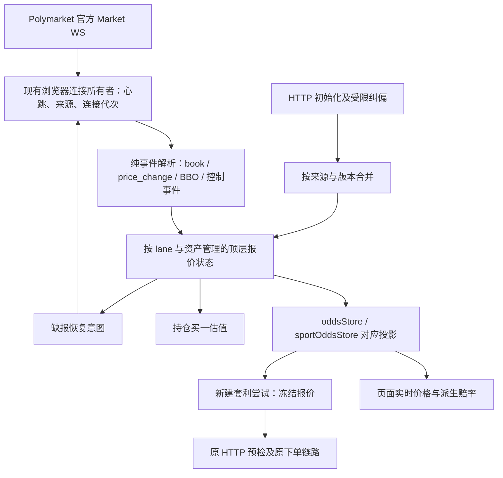

# PM 官方行情直连：实时价格同步改造方案

[changmen 扩展] 2026-11-07。状态：**整体方案待收敛；官方 PM-M 订阅优化及直连停用 Index 价格均已本机通过**，见 [订阅实施与后续安排](./PM_DIRECT_SUBSCRIPTION_UPDATE_20261107.md) 和 [停用 Index 价格实施记录](./PM_DIRECT_INDEX_PRICE_OPT_OUT_20261107.md)。本期仅解决浏览器直连 Polymarket 官方 Market WebSocket 时的价格接收、同步、恢复和显示；不改 VPS 行情转发服务。下文的大范围状态模型、阈值和阶段安排仍为被审计设计，不代表已实施或验收。

> [changmen 扩展] **2026-11-07 审计后状态：需收敛，暂不按下文全量实施。** 用户已明确目标为同一 token 的官网订单簿卖一。结合已安装官方 SDK `0.12.0` 源码及公开 API 离线检查，原方案存在 SDK 复用评估缺失、页面 rawAsk/缓冲价对照契约不闭合、纠偏时序元数据不完整等 3 项 P1，以及初始化、主动恢复、交易策略扩围和状态复杂度等 4 项 P2。详见 [审计报告及最小修订方案](./audits/PM_DIRECT_REALTIME_PRICE_PLAN_AUDIT_20261107.md)。下文保留为被审计版本，不再把自建恢复队列、同价重试抑制和 P0～P5 全量阶段作为首期必需；该审计轮次未实施业务代码，随后单独授权的订阅优化状态见上方实施记录。

## 1. 目标与本期范围

目标是让 CHANGMEN 持续显示当前已接收到的可买卖价格，并让页面与新建套利尝试读取同一份原始报价。验证重点为价格正确性、每个资产的覆盖率、事件到页面的延迟，以及断线后的恢复能力；预检失败次数只作为辅助指标。

“直连”在本文专指 **Market WS 的实际连接直达官方**，不是下单 HTTP、公共 HTTP 或 User WS 的路由。行情直连不能要求账号 HTTP 和提交 HTTP 也直连，不能依赖钱包、签名器或完整订单簿旁路的开关。

| 范围 | 本期安排 |
| --- | --- |
| 电竞 PM Market WS，包括电竞分类中的篮球 | 首先落地并完成浏览器验收 |
| 独立体育板的 PM Market WS 官方直连分支 | 复用纯解析及状态规则，独立会话、独立验证，安排在后续批次 |
| 官方直连自动回退到 CHANGMEN 转发 | 保留原路由选择及回退规则；停止本期直连状态机，回到原转发逻辑 |
| VPS `PM-MARKET`、`PM-SPORT-MARKET` 服务及其协议 | 不修改，不安排前后端同批升级，不增加版本协商 |
| 公共行情 HTTP | 原种子入口继续存在；可在异常恢复时受限读取官方公开订单簿，须单独记录实际响应来源 |
| FOK/GTC 预检、签单、提交、确认、结算 | 继续使用原执行链路；本期不启用 WS 订单簿执行预检 |
| 完整本地订单簿 Worker、动态预检旁路 | 保留原默认关闭状态及既有验收限制，不借本方案启用 |
| 其他场馆、C 行赛前历史价、POD 独立行情 | 不扩展其业务规则；共享解析改动须验证原调用方 |

本次用户要求是制定方案并写入文档，不包含实施、提交、push 或部署授权。后续发布继续服从 [AGENTS.md](../AGENTS.md) 和 [独立部署规范](./INDEPENDENT_DEPLOYMENT.md)。

## 2. 官方依据与设计解释

以下资料于 2026-11-07 查阅；官方协议事实与 CHANGMEN 设计分开记录。

| 官方资料 | 可确认的事实 | 本方案的采用方式 |
| --- | --- | --- |
| [Market Channel](https://docs.polymarket.com/api-reference/wss/market) | 提供 `book`、`price_change`、`best_bid_ask`；后者要求开启 `custom_feature_enabled` | 复用现有官方连接，归一化快照、增量和顶层报价 |
| [Real-Time Data](https://docs.polymarket.com/market-data/realtime-data) | Market WS 每 10 秒发送 `PING`；订阅集合可用 `operation` 更新；新增资产的 subscribe 会发送 book | 按资产补齐初始化与重连状态，使用标准增减订阅帧 |
| [Prices & Orderbook](https://docs.polymarket.com/concepts/prices-orderbook) | 买入对应 ask，卖出对应 bid；官网概率展示可能采用中间价或最近成交价 | 用同一资产的官方买卖报价验证，不能拿官网概率数字代替可买价 |
| [Prices and Order Books](https://docs.polymarket.com/market-data/prices-order-books) | 可读取公开订单簿及其 hash | 受限补缺、独立抽样对照；hash 不当作连续序号或单独的正确性证明 |

设计解释与限制：

- 本期无需更换实时行情 API。CHANGMEN 的订阅已开启 `custom_feature_enabled`，主要缺口在订阅完成度、状态传播和缓存合并。
- 首次连接请求快照；运行中对新增资产使用 `operation: subscribe`。不能把“新增资产会收到快照”解释为“重复 subscribe 已订资产一定能刷新快照”。
- 文档展示的 Market 事件没有可用来证明所有交易所事件完整到达的连续序号。本地序号只证明本应用交付顺序，不宣称能检测所有上游漏报。
- 顶层买卖价同步不等于完整深度簿同步；一个有效 BBO 可以更新顶层报价，不能据此宣布完整订单簿可执行。
- “长时间没有价格变化”与“连接失效”是不同事实。PONG 能证明连接活动，但不能证明每个资产均已订阅成功或没有漏报。
- 所有延迟、超时、并发和请求预算均为本项目提案，属于待实测参数，不是官方服务承诺或官方限额。

## 3. 当前证据与未确定原因

### 3.1 本轮现场记录

2026-11-07 的只读数据库核查确认：

| 记录 | 已确认事实 | 不能据此推出的结论 |
| --- | --- | --- |
| Link `1793983121679`，00:38:41 开始 | PM 检测赔率 3.448、检测限价 0.29；约 954ms 后订单簿卖一为 0.35，预检阻止提交 | 不能仅凭一次差价确定是行情延迟、瞬时跳价或缓存覆盖 |
| 同一资产 00:13～00:15 的记录 | 多次使用 0.54/0.58 检测价，订单簿卖一为 0.60～0.62 | 没有同期原始 WS 帧，不能还原每次旧价的具体写入者 |
| Link `1793983133324`，00:38:53 开始 | 后续尝试冻结 rawAsk 0.35、+1 tick 上限 0.36，预检通过，后续记录确认成交 | 不能证明此前整个连接已正常覆盖所有 token |

本轮临时隔离复现还确认：种子价 0.28 经预检纠偏为 0.35 后，在 MarketIndex 版本更新且未有新的 WS 写入时，下一个 30 秒种子同步可以覆盖回 0.28。临时测试已删除；实施阶段须将此场景落为正式行为回归。

本轮已有 10 个相关测试文件、82 项测试通过，另有上述 1 项临时复现通过。这是排查时的证据，不代替本方案实施后的验收。原始 WS 输入和当时实际直连/转发来源尚未留存，因此**不把截图事件直接归因为直连缺陷**。

### 3.2 当前源码中的具体缺口

下列路径相对仓库根，源码核查基线为 `c92d5ff7e` 及排查时本地工作区；实施前重新核对，不覆盖工作区已有改动。

| 入口 | 当前行为 | 本期处理 |
| --- | --- | --- |
| `client/packages/venue-browser/polymarket/api.ts` | 已开启自定义事件；提供全量 market 订阅帧 | 保留初始帧，增加明确的增减订阅构造 |
| `…/marketQuoteHub.ts` | 消费者资产取并集；变化时重复发送整组 market 帧；广播仅携带有效卖价 | 官方分支维护连接内订阅差集、资产就绪和显式清价事件 |
| `…/ws.ts` | `receivedQuote` 为连接级布尔；任意盘口帧可结束首次报价等待 | 保留连接保活；另增逐资产覆盖检查，不能用连接级成功替代资产成功 |
| `…/wsQuotes.ts`、`…/bookQuote.ts` | 空 book 的卖一不会形成更新 | 归一化明确的空侧、缺字段、坏字段，向下游传播清价 |
| `…/liveQuoteState.ts` | 以 token 保存源时间，纠偏时钉本机墙钟，并存在 2 秒无时间戳保护窗 | 直连分支按连接代次、资产生命周期及真实源时间合并，避免混用时钟 |
| `…/quotes/pmTokenQuote.ts` | 纠偏用 `source: http` 写 fo，`book-correct` 仅作指标分类 | 为直连受管报价保留可参与合并的纠偏来源及版本屏障 |
| `…/markets/collect.ts` | 种子只保护已有 mqtt 来源；从通用 getEntry 读取 | 种子不得覆盖直连有效报价、纠偏价或明确空盘；重建时也遵守此规则 |
| `client/web/src/stores/oddsStore.ts` | PM 重建快照保留一小时；只含现有行情字段 | 保留原存储职责，加入可验证的直连状态投影，不能给旧价续命 |
| `client/web/src/components/match/BetRow.vue` | 按 oddId 响应式读取 fo，赔率可含百分比或 +1 tick 缓冲 | 保留按资产更新方式；明确区分原始价与派生报价 |
| `client/web/src/components/order/controllers/useOrderListLiveQuotes.ts` | 持仓读取独立买一缓存 | 与对应 lane 的同一顶层报价版本对齐，空买盘及时清空 |
| `…/sportMarketWs.ts`、`…/sportQuoteHub.ts` | 体育独立连接；实际来源可能独立回退 | 后续批次单独接入，禁止复用电竞连接状态或互相清理 |

## 4. 目标链路与模块边界



落点原则：

1. 解析、报价状态机和订阅控制归 `client/packages/venue-browser/polymarket`；纯状态模块不依赖 Vue、Pinia、账号或服务端。
2. 连接只能由现有 `ws.ts` / `sportMarketWs.ts` 所有者持有。页面、预检和状态读取者不能另开连接或自行发送订阅。
3. 顶层报价为唯一合并决策者；应用层 store 只做一次同步投影，UI 和新尝试经同一投影读取，避免新旧双写竞争。投影完成后再通知消费者。
4. 一期继续以 `oddsStore.getPmQuoteEntry` 为电竞 UI/建腿共同入口。新增只读元数据通过公共 bridge 提供，不允许 adapter 反向导入 web store。
5. 电竞和体育使用同一纯算法的独立实例；键包含 lane、资产、代次。体育不能向电竞 fo 写入，也不能用另一连接的买一补当前连接的空值。
6. 完整订单簿 `client/packages/pm-market-data-browser` 保留原只读 feed、Worker 与执行隔离；本期顶层报价不依赖它启动。
7. 不向客户端引入 backend、DB 或 storage；无需 RDS 结构、后端接口或 VPS 变更。新增包内模块需要同步维护已有导出清单。

## 5. 报价状态与事件模型

### 5.1 最小状态

下面是设计形状，正式实现以现有类型与 bridge 边界为准：

```ts
type QuoteStamp = {
  source: "ws_book" | "ws_bbo" | "ws_delta" | "http_seed" | "http_correction";
  exchangeAt?: number;
  receivedMono: number;
  receivedWall: number;
};

type QuoteSide =
  | { kind: "unknown" }
  | { kind: "empty"; reason: "no_levels" | "no_executable_price"; stamp: QuoteStamp }
  | { kind: "price"; value: number; stamp: QuoteStamp };

type DirectQuote = {
  lane: "market" | "sport";
  assetId: string;
  streamEpoch: number;
  assetGeneration: number;
  revision: number;
  priceRevision: number;
  state: "waiting" | "live" | "suspect" | "disconnected" | "removed";
  bid: QuoteSide;
  ask: QuoteSide;
  lastAccepted: QuoteStamp;
  initializedBy?: "book" | "complete_bbo";
  correctionBarrier?: number;
};
```

- `revision` 表示状态或新输入被接受；`priceRevision` 只在有效买卖价、空侧或可用性改变时增加。PONG、同价重报及只变数量的事件不能自动解除同价重试抑制。
- 每侧独立保存来源与时间；一次仅更新 bid 的事件不能给旧 ask 续命，也不能以 bid 的新时间拒掉本可接受的 ask。`lastAccepted` 只描述记录最近一次变化，不代替每侧的新鲜度或排序依据。
- 初期使用现有校验精度和 tick 类型；不引入新的赔率舍入规则。原始价、缓冲价、显示赔率分别保留，不能反推三位赔率重建原始价。
- 计时使用本浏览器单调时间；墙钟只用于日志。交易所时间只作同源排序和带偏差标记的参考，不与 `Date.now()` 混成统一拒绝阈值。
- 时间戳相同的不同事件按本连接实际接收顺序处理，不仅按 timestamp 去重。明显未来时间或不可解析时间记录异常，不能永久压住后续健康帧。
- 值缺失是 unknown；明确无盘是 empty；格式错误是无效输入。unknown 或错误不能伪装成 0.01、旧价或对侧补价。
- `live` 是顶层报价状态。买入要求 ask 为 price，卖出估值要求 bid 为 price；一侧 empty 不锁死另一侧。`live` 不代表任意金额都能在卖一成交。

### 5.2 输入归一化

| 输入 | 处理规则 |
| --- | --- |
| 有效 `book` | 对该资产原子替换双侧顶层价；从有效数量档位取最高 bid、最低 ask，不依赖数组顺序 |
| `book.asks: []` / `bids: []` | 对应侧明确清空；对侧保留本次完整快照的结果 |
| book 缺少必需数组、坏价格或不合理数量 | 记异常；能定位资产则置 suspect 并受限补证，不能误当健康空盘 |
| `best_bid_ask` | 存在的字段独立更新；缺字段不清另一侧。显式空值及边界值先经协议样本核对，再映射为 empty 或 invalid |
| `price_change` | 读取每条变化的 `best_bid/best_ask`；不能把变化档位 `price` 当作当前卖一 |
| `price_change.size = 0` | 这是某档删除；仍以给出的最新顶层字段更新。字段不全时不凭该价格推断整侧为空 |
| `last_trade_price` | 只作成交信息，不能覆盖当前买一/卖一 |
| `tick_size_change` | 继续交给 tick 元数据入口；通知派生报价失效/重算，已冻结尝试保持原执行校验 |
| `market_resolved` | 传播终局状态，关闭实时可用性；不能由旧缓存或 HTTP 种子复活 |
| 同帧多个资产 | 按资产分别投递；健康同伴不因一个可定位的坏资产全体失效 |

实现前固定官方真实样本，特别确认 `best_ask = 1`、`best_bid = 0`、null 和字段缺失的区别。边界价格可能表示没有可执行价，也可能是实际边界档位；CHANGMEN 的现有可交易区间检查继续保留，不能直接当普通赔率参与套利。

## 6. HTTP、WS 与纠偏的合并规则

### 6.1 种子保护与缓存重建

直连状态机激活期间，MarketIndex 只提供资产映射及初始化候选。未接到官方报价时可以展示明确标记的“初始化价格”，但不能标成实时；进入 live 后，种子不再覆盖 WS、HTTP 纠偏或明确 empty 状态。

`clean(Polymarket)` 不是连接重建。其保留快照必须带原来源、状态、接收时间、revision 和代次；恢复投影不能更新 receivedAt，也不能丢失“此资产已被实时数据接管”的信息。assetGeneration 或 streamEpoch 改变时，旧快照只可作历史展示，不能恢复新连接的 live。

引入明确的 PM 来源元数据，不把 book-correct 伪装为 mqtt。原通用 `source: http/mqtt` 可用于原闪烁样式，但不能继续单独决定直连报价可信度。相关 PM 状态须通过公共 bridge 读取，覆盖“实时 bucket 为空但 PM snapshot 尚在”的场景。

### 6.2 预检纠偏和在途请求

1. 在预检 HTTP 请求开始前捕获 lane、streamEpoch、assetGeneration、请求序号和当前 revision。
2. 收到高于冻结上限的订单簿后，原尝试照常失败；纠偏只更新后续显示及新尝试的原始报价，不提高当前 cap。
3. 若期间已接受可比较且更新的 WS 报价，不用迟到 HTTP 覆盖它；若无法证明顺序，则记录差异并进入受限核对，而非盲选更便宜的价。
4. 使用订单簿可信 exchangeAt 和本地请求区间形成纠偏屏障，不能把响应到达的本机墙钟当交易所时间。
5. 无有效源时间时，只能作来源较弱的纠偏；旧种子仍禁止覆盖。后续无时间或冲突 WS 需按有限恢复流程补证，不能无限冻结在某个纠偏价。
6. 连接、资产、来源或会话已变时，丢弃旧请求的报价副作用；原订单请求本身的错误处理和计时不改。
7. 同价且无可用性变化时不循环写 fo，不触发全表刷新；诊断可以记录输入，显示和套利版本不因该记录反复变化。

纠偏响应来自原订单预检实际使用的 HTTP 路由，其来源单独记录，不能因 WS 是官方就标记它也来自官方直连。

## 7. 每个资产的订阅与恢复

### 7.1 所有者持有的集合

现有 hub 为每条连接维护 desired（消费者并集）、sent（本连接已发送）、initialized（已接到有效初始化输入）及 pending（待初始化）集合。sent 不等于服务器确认；只有实际输入和受限补证可以说明该资产已取得报价。

- 首次连接：发送 market 帧，开启自定义事件并请求初始快照；本连接所有 desired 进入 waiting。
- 新增资产：只向官方连接发送新增差集 `operation: subscribe`，为新增资产启动独立等待期限。
- 移除资产：最后一个消费者不再需要时发送 unsubscribe，撤销该资产代次和所有旧恢复任务。
- 同一资产被多个消费者使用：只维护一份订阅。一个消费者退出不能退订另一个仍使用的资产。
- 重连：streamEpoch 增加，sent 清空，按最新 desired 重新初始化。旧回调和旧 HTTP 返回不能写入新连接。
- 不因局部缺报重连整个 WS；连接真实失效仍由原 transport 所有者处理。

### 7.2 顶层报价就绪与完整簿边界

有效 book 可以初始化顶层价；当前连接收到自包含的完整 BBO 也可以初始化顶层报价。缺一侧的 BBO 只更新该侧，不能宣称双侧覆盖完成。诊断分别计量“ask 已知”“bid 已知”“完整 BBO 已知”和“收到 book”，不能用一个布尔掩盖部分覆盖。

完整 BBO 仍不能充当完整订单簿快照。原本地簿 Worker 若缺 book，继续等待 book；本文不能改变其快照、深度或执行证明规则。

### 7.3 恢复流程与提案预算

| 项目 | 初始提案 |
| --- | --- |
| 初次报价等待 | 发送订阅后 3s 做诊断标记，8s 启动补缺；收到同伴资产事件不能延长期限 |
| 单资产任务 | 每个 lane/epoch/assetGeneration 最多一个，重复请求合并 |
| 官方公开 book 补缺 | 最多 2 并发，单次超时 3s；全页平均至多 2 请求/秒、30 次/分钟 |
| 单次恢复预算 | 最多 2 次 HTTP 尝试，退避 2s/4s 并加抖动；全页队列最多 128 个资产，超额记 unavailable |
| 订阅修复 | 仅由原所有者执行单资产 unsubscribe/subscribe；全连接每 2s 至多一次，单事故最多一次 cycle |
| 冷却 | 事故预算用尽后至少 60s；保留 unavailable 状态，禁止无限循环 |
| HTTP 预算冲突 | 页面可见资产优先，其次已有套利关注资产；诊断最低优先级。不得占用订单执行请求的并发槽 |

首次缺报先核对 desired 和发送记录，再使用受限公开 book 补缺；HTTP 只能提供当前单次快照，不能证明 WS 的该资产后续增量已恢复。连续输入仍未恢复时，由所有者进行一次受限订阅修复，并等待新 epoch/资产边界后的有效 WS 输入。发送成功本身不算恢复完成。

恢复用的公开 HTTP 必须能报告实际来源；不能通过“可自动回退 VPS”的 helper 把回退响应标成 direct。若官方公开 HTTP 因 CORS、网络或现有设置不可用，则记录不可用，继续受限 WS 恢复，不修改用户的 HTTP/提交路由。

退订/重订过程中取消任务时，所有者必须根据最新 desired 补偿已发出的 unsubscribe；没有业务需求时不补订。来源已经回退为 changmen 时取消直连任务，不能继续向转发服务发送本期的主动修复命令。

所有预算为全连接共享，不为每个组件创建定时器。订阅恢复需要与原单一发送队列串行，不能插入交易提交锁或要求已有 FOK 等待恢复。

## 8. 连接健康、后台恢复与来源切换

### 8.1 分开判断连接和资产

| 观察 | 结论与动作 |
| --- | --- |
| 正常 PONG，某资产价格未变 | 连接存活；保留该资产最后有效价格，不按静默秒数自动清价或循环补簿 |
| 正常 PONG，但某资产从未初始化 | 该资产 waiting；启动其受限补缺，其他资产照常更新 |
| 正常 PONG，局部字段损坏或发生明确内部丢帧 | 相关资产 suspect；记录边界并恢复，不把 socket open 当作有效行情证明 |
| 连接断开或原 transport 判定心跳超时 | 同步撤销该连接的实时有效性；原 transport 处理重连，UI 显示重连中 |
| 连接来源由 official 变成 changmen | 取消所有旧直连恢复与 HTTP 副作用，释放直连所有者；按原转发逻辑消费新输入 |
| 返回 official | 启动新直连会话、建立新代次；不能带回上次 direct 的 live 标记 |

一期不凭连接标签修改原自动回退规则。直连状态机依据 socket 创建时冻结的实际来源，而非随时可能变化的全局偏好。体育连接内部的 `sourceMode` 与电竞配置可能不同，必须由其 transport 向所属 hub 报告真实来源。

### 8.2 浏览器后台与休眠

- 正常 hidden/visible 不等于丢帧；避免切回前台即断线或全量重订。隐藏时可以合并 UI 通知，但状态必须保留最新完整顶层值。
- 明确 freeze/resume、页面丢弃重建、连接变化或内部队列溢出时，撤销受影响会话的实时有效性，取消过期恢复任务，按真实需求初始化。
- 浏览器暂停后先给原心跳恢复留出已有的回复窗口；恢复定时器按保存的单调截止时间重新判定，不补跑全部错过的 tick。
- 第一帧覆盖不足时仅恢复相关资产，避免 100 个盘口同时发 HTTP；全连接共享预算在恢复前台后仍然生效。
- 历史价格可淡化保留并注明“待恢复”，但不能作为当前可用价格传给新建套利尝试；不得显示成普通场馆锁盘或已经结算。

## 9. 页面、套利与持仓的读取方式

### 9.1 页面更新

保留 BetRow 按 oddId 追踪响应式 Map 的方式。事件到达后立即完成状态合并与 store 投影；同一渲染帧内多次变动只通知一次受影响资产。禁止每次报价全量重建赛事列表、调用全表 refresh 或广播全局行情 revision。

正常状态保持现有主赔率展示；仅 waiting、suspect、disconnected、empty 时显示简短状态。诊断详情提供原始 ask/bid、报价缓冲模式、cap、来源和时间，不把这些内部字段铺进主操作流程。

原始卖一与派生赔率分别验收。例如原始 ask 为 0.35、+1 tick 为 0.01 时，执行 cap 为 0.36，主赔率按现有规则为 2.777；不能把 1/2.777 与官方 0.35 比较后判定行情错误。手续费旁显也继续单独派生，不写原始行情。

### 9.2 新建套利尝试

- UI 和新尝试必须通过同一份已投影状态取得 rawAsk、cap、displayOdds、lane/epoch/assetGeneration 和 priceRevision；冻结过程中不异步重新读一遍价格。
- waiting、suspect、disconnected、removed、empty ask 等明确不可用状态不能以旧 fallback 还原为新机会；只阻止新尝试，不能修改已开始尝试的 cap 或凭空补发订单。
- 同一资产因 price-above-detection 失败后，将失败关联到报价 priceRevision 与当时的冻结 cap。完全相同的失败报价不应在主循环中不断新建尝试。
- 收到价格、有效性或 tick 策略改变后重新评估；不能仅因 PONG、日志写入、同价重报、数量变化或随机冷却到期就认定价格已纠正。
- 抑制状态不能永久冻结资产：正常解除依赖新有效价格；有限超时只允许请求一次受预算约束的核对，取得新证据后再重新评估。
- 拦截理由分别为“行情等待/待核对”与“真实订单簿高于冻结上限”。保留原 HTTP 预检，价格实时显示不代表能消除下单前的正常跳价。

本节会改变新机会准入和重试行为，必须在对应实施批次单独验证。不能将其混入纯展示改动、按展示白名单省略完整业务回归。

### 9.3 持仓估值

持仓继续读取本 lane 的实时 bid。bid empty 时及时显示无可用买价，不能回退到买入 ask、最近成交价或另一连接的历史 bid。订单原始成交价、成交赔率、手续费及结算事实不随行情变化而改写。

独立体育板接入时保持 `sportOddsStore` 的职责；不把体育报价灌入电竞 fo。若同一资产同时存在于两条连接，按明确的订单/比赛上下文选 lane，不使用无条件 `marketBid ?? sportBid` 掩盖当前 lane 的缺价。

## 10. 指标、采样与验收标准

### 10.1 必须能拆解的时间与计数

| 指标 | 定义与用途 |
| --- | --- |
| desired / sent / initialized / live / empty / suspect / missing | 按 lane、连接代次统计覆盖率；sent 不计为 initialized |
| socketReceived → normalized → stateApplied | 同浏览器单调时间，衡量解析及同步投影耗时 |
| stateApplied → visibleFrame | 组件实际显示值被更新，并在后续 rAF 检查，作为绘制延迟近似；不宣称物理屏幕显示时间 |
| exchangeAt → socketReceived | 只在源时间可解析且时钟偏差已估计时报告；否则标为不可比较，保留原值供诊断 |
| quoteAge / lastFrameAge / lastPongAge | 分别报告，不把盘口静默等同断线，也不因 PONG 改写 quoteAge |
| seedOverwritePrevented / correctionAccepted / correctionSuperseded | 证明来源合并规则实际生效 |
| emptyApplied / oldEpochRejected / invalidFrame / deliveryGap | 检查清价、旧回包和内部交付问题 |
| recoveryQueued / httpAttempt / cycleAttempt / recoveryExhausted | 证明恢复预算有效且不会形成风暴 |
| priceAboveDetection / repeatSuppressed | 按资产、价格版本和等待耗时分组；不把该数量单独作为实时性达标依据 |

为该功能使用独立、按需的观测接口；不要复用现有只读 marketStream 来引入默认常驻原始帧录制。已有 marketStream 的本地 sequence 仍保留原观察语义，不能改称交易所序号。

建议默认只保存计数与最多 256 条脱敏事件引用；主动诊断会话才打开有界原始公共行情环形缓冲，例如最多 2MiB/30s，先到上限即淘汰，导出标注是否截断。不得记录账号凭证、钱包签名、Cookie、认证 token 或带认证参数的 WS URL；默认不向 RDS 上传逐 tick 行情。

### 10.2 初始工程目标

下面是拟定的本机前台验收目标，P0 实测后可以调整，但调整必须连同理由留档，不得宣称为官方保证。

| 项目 | 初始目标 |
| --- | --- |
| 正确性 | 确定性回放中，已接受输入与最终顶层价一致率 100%；空盘残留、旧代次复活、种子覆盖 live 均为 0 |
| 接收至状态投影 | P95 ≤20ms、P99 ≤50ms |
| 状态投影至可见帧 | P95 ≤50ms、P99 ≤100ms；仅统计前台且实际有变化的可见资产 |
| 接收至可见帧 | P95 ≤100ms、P99 ≤200ms；单独保留长任务及浏览器冻结导致的异常样本 |
| 初始化 | 正常网络下新增资产 3s 内 ≥99% 取得有效顶层报价；缺失者 8s 内进入明确恢复/不可用状态 |
| 空侧传播 | 明确空盘输入被接受后，前台 100ms 内消除普通可交易显示，并撤销该侧的新机会可用性 |
| 重连恢复 | 新连接建立后正常样本 3s 内 ≥99% 资产恢复；失败者按预算转为明确不可用，不残留旧 live |
| 请求约束 | 正常健康静默盘口不产生固定频率 HTTP 或重订阅；异常恢复不超第 7 节预算 |
| 负载 | 在相同资产数和行情回放负载下，记录主线程占用、长任务、内存及通知数；不能靠丢失最终状态改善延迟 |

上游发出到浏览器收到的网络延迟单列报告，本期不凭本地优化承诺固定端到端网络时延。若数量不足，报告样本数和缺项，不能用少量样本的 P99 声称达标。

### 10.3 真实浏览器观察方法

1. 在用户实际网络及本机开发服务上，确认实际 Market WS 来源为 official，记录浏览器版本、资产数、可见行数、报价缓冲模式和本次代码版本。
2. 前台连续观察至少 30 分钟，覆盖至少 10 个资产，尽量包含 5 个活跃与 5 个安静资产；每个 lane 单列。若市场不满足数量，延长或另选样本并标明限制。
3. 延迟目标至少采集 1,000 个有效价格变化样本；同价心跳不加入价格变化分母。价格正确性回放覆盖全部输入，不能只抽“看起来正常”的事件。
4. 同一已授权官方连接旁路记录输入和最终显示，逐资产对齐；不为了验收默认再开一条全量 WS。需要独立连接对照时明确记录诊断连接的短期资产和资源成本。
5. 受限公开 book 抽样对照保留 requestStart/responseEnd 及响应中的 timestamp/hash；区间内有 WS 变化的样本标为并发变化，不能直接算错误。无法对齐的差异留存证据，不宣称零差异。
6. 完成新增/移除资产、断网重连、后台 5 分钟后回前台、电脑休眠恢复、旧 HTTP 迟到和 official→changmen→official 的受控场景；暂停期间不纳入前台绘制指标。
7. 把截图涉及的同一 token/同类高波动地图盘口纳入有条件复核；历史已结束市场不能拿当前无价当作历史故障复现。
8. 实测全程只读观察与模拟执行，不使用真实投注来验证价格同步。输出采样范围、失败案例、误差解释及未覆盖项。

## 11. 分阶段实施与进入条件

各阶段独立形成可审查改动，保留同一代码候选与证据关联；阶段完成不等于获得生产启用或发布授权。

### P0：取证与固定契约

- 固定现场失败/成功案例、种子覆盖复现及官方公共帧样本，保存脱敏 fixture。
- 测量当前官方直连链路接收、写 fo、显示的基线；逐资产统计覆盖率，确认哪些缺口能在直连实测复现。
- 固定正式类型、来源、空值语义、lane 键及性能目标；列出本地未提交 PM 旁显改动，避免误纳入本任务。
- 交付：基线报告、输入样本、类型设计和本次改动路径清单。若尚无真实直连证据，明确记录，后续不沿用截图作为根因证明。

### P1：电竞直连报价正确性

- 实现归一化、逐侧状态、直连报价合并和一次性 store 投影。
- 修复种子覆盖纠偏、空盘留旧价、缓存重建丢来源、跨时钟/跨代次污染；保留百分比和 +1 tick 转换。
- 用现有官方连接接入，新代码仅在实际 official 分支运行；本批不加入同价重试抑制、不调整订单准入以外的执行逻辑。
- 交付：行为回归、直连前台显示记录、原转发路径回归；确认完整订单簿旁路没有被启动。

### P2：电竞直连订阅覆盖与恢复

- 官方分支接入差集订阅、逐资产初始化、有限恢复、连接代次及取消补偿。
- 区分连接 PONG 与资产覆盖，完善后台恢复及实际来源切换。
- 增加有界诊断和故障注入用例，验证缺报不会影响健康同伴，恢复不会扩大消费者 desired 集合。
- 交付：逐资产覆盖报告、恢复预算证据、订阅发送顺序记录和断网/休眠验收。

### P3：电竞直连页面、套利与持仓对齐

- 新尝试携带同一报价版本；明确 waiting/empty 等状态的准入行为，加入同失败价格版本的重复触发抑制。
- 持仓 bid 与页面 ask 按同 lane 的状态对齐；仅优化受影响资产通知和绘制，不引入全表刷新。
- 校验原始价、缓冲 cap、显示赔率及手续费旁显的不同口径；按本阶段完整业务影响验证 FOK/GTC。
- 交付：延迟分位数、重复旧价尝试计数、完整 FOK/GTC 行为回归、原签单/提交事实未改变的证据。

### P4：独立体育板官方直连

- 为 sport transport 暴露真实来源/代次，复用 P1/P2 的纯模块，保留独立订阅、生命周期和 sportOddsStore 投影。
- 对同一 token 双 lane 并存、体育独立回退、体育退出不影响电竞、电竞切源不误报体育实际来源分别验证。
- 体育单独达到 P0～P3 同等正确性、覆盖与性能要求后再启用；电竞验收不自动转为体育验收。

### P5：集中验收及发布候选

- 完成第 10 节真实观察，核对所有失败与未覆盖项；检查回滚能够停止新增计时器、HTTP 与订阅恢复。
- 按本次代码范围运行 `npm run check:change:plan` 和 `npm run check:change`，形成与候选绑定的报告。
- 产出简明候选说明、实际启用范围和回滚步骤。push、部署与生产开关启用须有本次明确指令；本方案不安排自动发布。

## 12. 计划改造文件

新增文件为建议名，实施时允许与现有模块合理合并，但职责不能混回组件或交易执行模块。

| 路径 | 计划职责 |
| --- | --- |
| `client/packages/venue-browser/polymarket/quotes/pmDirectQuoteState.ts`（拟新增） | 纯状态与逐侧来源合并，不持有网络、不读全局配置 |
| `…/quotes/pmDirectQuoteRecovery.ts`（拟新增） | 恢复调度和预算；通过现有所有者注入的受限端口工作 |
| `…/wsQuotes.ts`、`…/bookQuote.ts`、`…/marketMessage.ts` | 规范化顶层数据与空侧语义，明确原调用方兼容边界 |
| `…/api.ts`、`…/marketQuoteHub.ts` | 官方订阅差集、资产代次与状态广播 |
| `…/ws.ts`、`…/liveQuoteState.ts` | 实际来源/epoch/连接活动；直连合并从旧全局 token 时间表隔离 |
| `…/markets/collect.ts`、`…/quotes/pmTokenQuote.ts` | 种子、WS 和预检纠偏统一进入直连合并器 |
| `client/packages/client-core/src/bridge/oddsAccess.ts` | 必要时增加只读 PM 元数据端口，保持原场馆接口语义 |
| `client/web/src/stores/oddsStore.ts` | 直连原子投影、清价及缓存重建元数据，不在 save 内引入网络 |
| `client/web/src/domain/polymarket/tickBufferQuote.ts` 及 `src/services/polymarketQuotes.ts` | 冻结报价与版本对齐，不改变价格计算公式 |
| `client/web/src/stores/betting` 相关新尝试入口 | P3 的明确状态准入与重复触发抑制，按实际调用链确定最小落点 |
| `client/web/src/components/match/BetRow.vue`、订单报价 controller | 可见价格、异常状态和局部通知；不创建独立订阅 |
| `…/sportMarketWs.ts`、`…/sportQuoteHub.ts`、`client/web/src/stores/sportOddsStore.ts` | P4 独立接入；不与电竞 store 互写 |
| 上述模块既有测试目录 | 新增语义、恢复、时序及业务回归 |

当前导出布局与边界以 [WORKSPACE_LAYOUT.md](./WORKSPACE_LAYOUT.md) 和 [TEAM_BOUNDARIES.md](./TEAM_BOUNDARIES.md) 为准；不恢复已退役的 `packages/venue-adapter` 浏览器实现。本期不修改 `server/ws_forward`，也不为了该方案升级整套 SDK 或重构订单执行模块。

## 13. 必需测试矩阵

| 类别 | 关键用例与通过条件 |
| --- | --- |
| 官方帧解析 | book、BBO、嵌套 price_change、数组帧、PONG、成交事件；买入 price 不被成交价或变动档位替代 |
| 空盘与边界 | asks/bids 空数组、单侧缺字段、显式 null、0/1、坏数量；空侧正确清理，健康对侧不被清空 |
| 同时间戳 | 同 ms 多帧及同帧多资产都能按接收顺序更新，不能仅因时间相同丢掉有效变化 |
| 种子覆盖 | 0.28→纠偏 0.35→新版本旧种子，最终保持有效纠偏；随后真实新 WS 允许合理升降 |
| 缓存重建 | clean 后保留来源/代次/原时间/空盘状态；新种子不能复活旧卖价 |
| HTTP 竞态 | 先请求后 WS 更新、旧响应迟到、跨 epoch/资产重加入/来源切换，旧副作用全部被拒绝 |
| 资产覆盖 | 多资产仅一份收到快照时，其余仍 waiting；同伴帧不能延长等待期限 |
| 增减订阅 | desired 差集准确，多消费者退出不会误退订，回调晚到不会重新加入已移除资产 |
| 恢复预算 | 多处请求合并、最大并发、速率、超时、冷却、队列上限均有效，安静健康资产不触发风暴 |
| 取消补偿 | unsubscribe 后取消、退出、fallback、连接更换，补偿与最新 desired 一致，不向错误 socket 发送 |
| 心跳与后台 | PONG 正常且静默、心跳丢失、休眠后恢复、明确内部间隙；连接状态与资产状态不混淆 |
| 来源隔离 | official→changmen→official，回退维持旧逻辑；旧 direct 请求不得修改新线路报价 |
| lane 隔离 | 同 token 在电竞/体育同时出现，价和时间不互相门控，清空一条连接不借另一条连接的价格填充 |
| UI 一致 | rawAsk、buffer cap、displayOdds 口径正确；无全表刷新，同帧更新最终值正确，empty 不残留可交易价 |
| 策略对齐 | UI 与新尝试同 revision；同价重报不反复触发；新有效价格和核对结果可解除抑制 |
| FOK | 百分比/+1 tick、价格上升拒绝、限价内深度、最小份数、签名前后 tick 校验、单次提交不变 |
| GTC | 手动冻结输入、预检失效、原挂单/撤单/确认路径不因实时价更新而重新定价或重复提交 |
| 持仓 | bid 更新/清空及时；成交事实与结算金额不被实时价改写 |
| 资源生命周期 | 多组件挂载只用现有连接；停止后无新增计时器、worker、HTTP 或迟到投影 |
| 原路径回归 | CHANGMEN 转发消费者及其他场馆保持原行为；纯模块新增空事件不会意外传播到旧路径 |

后续实施验证按 [AGENTS.md](../AGENTS.md) 选所属模块完整回归。前端构建已包含类型检查，不重复串联 typecheck；未构建时至少执行前端类型检查。涉及父级控制、行情/交易共享链路不能按纯展示豁免。普通业务改动不追加固定 551 项历史专项，也不追加验证器自身回归，除非本次实际修改相关验证器。

本次仅新增本方案及文档索引链接，按纯文档范围做格式、链接和路径核对，不因工作区已有其他代码改动代跑其全量验证。

## 14. 本机启用、回滚与风险控制

实施时拟提供独立直连报价功能门控，电竞和体育可分别启停；开关名称在 P0 固定，不能复用 `local-book`、`ws-book-shadow` 或 FOK optimized 开关。开发阶段默认关闭，测试显式开启；验收后是否成为官方直连默认行为另行记录。

启用顺序为：P1 正确性→P2 恢复→P3 套利准入与重复抑制；体育在 P4 独立启用。真实行情观察开启不包含真实下注授权。功能开始使用某个资产时，先以只读状态接收并确认新输入，再由唯一写入入口原子切换到新合并器；不能新旧同时写，也不能以全量清空 fo 作为迁移方法。

出现以下任意情况应回滚该功能候选：

- 错误侧别、空盘残留、旧 epoch/旧 HTTP 复活、种子覆盖已确认实时价。
- UI 和新尝试读取不同报价版本，或当前尝试的冻结 cap 被跟价改写。
- 新增重复连接、超预算请求/订阅、取消后仍恢复资产或资源不能释放。
- 转发路径、既有 FOK/GTC、体育/电竞隔离出现回归。
- 价格正确性尚未证明，或可比较负载下长期达不到确定的本地延迟目标且原因未解释。

回滚操作必须由应用监督器同步完成：取消直连恢复并撤销代次，停止新增副作用；由唯一原连接所有者按最新 desired 完成必要订阅补偿；撤销新状态的实时标记，再交回旧路径。不得只关 UI 而保留后台恢复计时器。已提交订单继续由原监控处理，不撤单、不重新定价、不补发。源码/发布回退按仓库发布规范执行，不改用户行情或下单路由作为隐式回滚。

## 15. 完成定义与后续边界

一期电竞直连完成须同时具备：正式可复现的价格合并回归、逐资产覆盖与缺报恢复证据、真实前台延迟报告、空盘/重连/休眠/来源切换验收，以及 FOK/GTC 和原转发分支回归。某项没有证据必须列为未完成，不能以预检拦截减少替代。

体育完成另有独立证据。VPS 转发改造、远端排队优化、全量深度展示、WS 执行预检、SDK 整体迁移、默认来源切换均不在本期完成定义中。

与现有文档的关系：

- [PM 报价转换边界](../client/web/docs/PM_PRICE_QUOTE_PIPELINE.md)：保留其纯报价转换与冻结 cap 规则；实施后补充直连原始报价状态入口，不把本方案提前写成现状。
- [PM 预检优化方案](./PM_PRECHECK_OPTIMIZATION_PLAN.md)：继续管理真实 HTTP 预检及执行优化，本方案不替代其验收。
- [共享订单簿方案](./PM_SHARED_ORDER_BOOK_REFACTOR_PLAN.md) 与 [订单簿恢复及取证方案](./PM_BOOK_RECOVERY_AND_EVIDENCE_PLAN_20261017.md)：原限制继续适用于完整簿旁路；本方案是顶层报价主链路的新设计，不能以此解除既有 NO-GO。
- [PM C 行历史价](./PM_PREMATCH_PRICES.md)：保留独立历史口径，不能用本期实时价覆盖历史观测。

后续实施报告至少记录代码版本、实际直连 lane、启用参数、验证命令、样本数量、性能分位数、失败与未覆盖项、回滚演练，以及是否实际发布。本文件当前状态仍为“尚未实施”。
