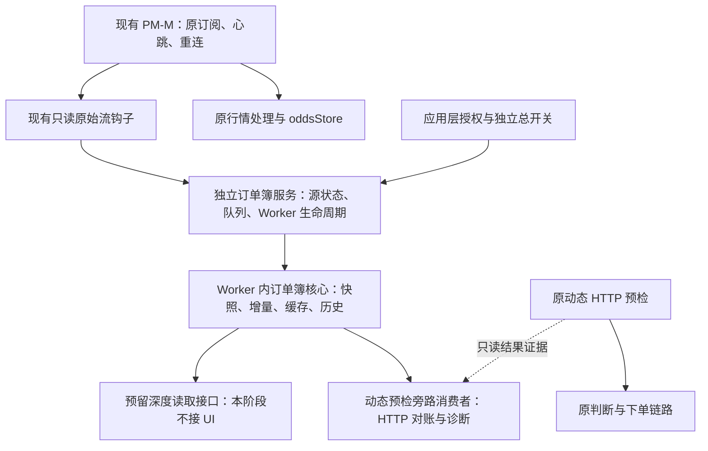

# PM-M 共享本地订单簿：生命周期拆分方案

[changmen 扩展] 2026-10-17 后续设计见 [Nautilus 快照恢复与差异取证方案](./PM_BOOK_RECOVERY_AND_EVIDENCE_PLAN_20261017.md)。先取证和无网络状态机；主动恢复涉及共享订阅，独立评审并默认关闭。本次只更新方案，没有实施、构建、测试或改动经典 FOK；下方 NO-GO 保持。

## 最新验收：本版生产旁路 NO-GO（2026-10-17）

[changmen 扩展] 本版 30 分钟真实浏览器观察和后台恢复已完成，但保留 1 条独立对账差异及一个缺快照的真实深度推进未满足项；**暂不放行生产旁路灰度**。实际预检仍 HTTP、默认关闭、经典 FOK 不变、未发布。详见 [本版浏览器审计](./audits/PM_BOOK_BROWSER_CONTINUITY_AUDIT_20261017.md)，下文旧版灰度判断不自动转移至本版。

[changmen 扩展] [Builder/公开源码对照](./PM_ORDER_BOOK_EXTERNAL_DESIGN_REVIEW_20261017.md) 将后续重点收敛为差异原状态取证和行情持有者的资产恢复协议。保留共享簿与消费者分离；本轮不新增连接、重订阅、HTTP 补簿或交易改造。

## 当前状态：资产隔离与模块职责整理（2026-10-17）

[changmen 扩展] 本轮已把可定位的 tick/坏帧/完整性疑点收窄为资产级失效，保留断线、消息间隙和资源异常的整体失效；资产移除/重新加入不撤销健康资产或复活旧证明。订单簿核心保留原时间的行情状态，新鲜度策略由动态消费者执行，阈值未放宽；执行元数据改用独立消息，历史独立 WS 适配器移到测试目录，重复线路轮询已合并。

**实际预检仍 HTTP，两个开关默认关闭，经典 FOK 与 PM-M 订阅重连不变，未发布。** 本轮实施、回归、复审和启用边界以 [资产隔离复审](./audits/PM_BOOK_ASSET_ISOLATION_REAUDIT_20261017.md) 为准。下文各轮“最新”标题及浏览器指标为历史记录，不能直接替代本轮 Worker 的浏览器验收；真实快路径仍 NO-GO。

[changmen 扩展] 2026-10-16。**状态：已按本方案实施生命周期拆分，默认关闭、实际预检仍 HTTP、未发布。** 实际落点见 [重构审计](./audits/PM_SHARED_ORDER_BOOK_REFACTOR_AUDIT_20261016.md)，最新回归和生产旁路结论以 [消息调度复审](./audits/PM_MAILBOX_SCHEDULING_REAUDIT_20261017.md) 为准；下文保留设计和验收要求，历史 [批量消息桥复审](./audits/PM_PASSIVE_BOOK_BATCH_REAUDIT_20261016.md) 不自动转为本版放行。

## 1. 要改什么

2026-10-17 后续验收：重构时的消息年龄超时与后台证据缺口已由 [消息调度修复复审](./audits/PM_MAILBOX_SCHEDULING_REAUDIT_20261017.md) 跟进。事件驱动唤醒保留原资源限制，真实后台及恢复验证通过；**具备 1 位直连动态用户的生产旁路灰度条件**。默认关闭、实际预检 HTTP；本次未发布、未开启。上方重构审计保留历史失败证据。

目标是：**复用现有 PM-M 原始流，由独立订单簿服务管理 Worker、缓存和生命周期；动态预检只消费订单簿，另提供只读深度接口。** 本阶段动态预检只做旁路对照，实际预检继续原 HTTP。

重构前已独立的是归并核心，运行实例仍归动态旁路持有；本轮按下表完成归属拆分：

| 当前代码 | 当前职责 | 重构后的归属 |
| --- | --- | --- |
| `client/web/src/runtime/pmDynamicWsPreflight.ts` | 动态模式、登录和旁路开关门控，启动动态运行时 | 应用层负责订单簿会话授权；此文件只管理动态消费者 |
| `client/web/src/runtime/pmDynamicWsShadowWorker.ts` | 创建 Worker 客户端，选择候选，监听账号，停止整套运行时 | 保留业务候选、直连账号资格、消费者 scope；不创建或终止 Worker |
| `submission/preflight/optimized/wsBook/shadowWorkerClient.ts` | PM-M 观察、消息队列、Worker 生命周期、动态比较协议 | 中性的源观察、队列、生命周期移入订单簿服务；比较适配留在动态消费者 |
| `submission/preflight/optimized/wsBook/bookRuntime.ts` | 创建 feed、保存簿历史、HTTP probe、元数据和比较 | feed/缓存/历史归订单簿模块；HTTP/元数据/预检比较归动态消费者 |
| `realtime/orderBook/passiveBookFeed.ts`、`bookReducer.ts` | 快照与增量归并、有效性和资源约束 | 继续作为独立订单簿核心，优先保持算法与阈值不变 |

以上短路径均相对于 `packages/venue-adapter/polymarket/`，前端路径除外。

图中没有订单簿到实际预检返回值或下单入口的连线。也不增加第二条 PM-M WS、第二套订阅或 HTTP 快照补簿路径。

## 2. 不可改变的边界

- 不改变 PM-M 原来的订阅集合、发送顺序、心跳、重连、换线、关闭和保活行为；不阻塞原行情处理，不写 `oddsStore`。
- 只使用现有 `marketStream` 观察接口及 `marketQuoteHub` 的只读资产查询。不得调用行情 consumer 注册/注销来扩大订阅，也不得调用 `startPolymarketMarketWs`。
- 经典 FOK、默认/缺失/非法模式仍走 `legacy`。不新增拒单门控、准备要求、历史查询等待或后台订单簿负载；原 signer 自动准备、价格金额、深度、双腿顺序、单次提交、确认、补单和绑定规则不变。
- 原动态 HTTP 请求、错误、计时和返回值不变；旁路开始、结束、失败均不得被真实预检 `await`。不把 HTTP 对账结果注入本地 WS 簿。
- 不修改 VPS、中转、后端、数据库、钱包与订单提交。体育独立行情流不在本阶段范围。
- 默认关闭。深度展示只提供接口和测试消费者，不增加页面、不替用户启用，也不借此给经典模式开放服务。

## 3. 生命周期与依赖方向

### 3.1 三层各自拥有的资源

**应用层会话监督器**决定本阶段是否允许订单簿运行：独立总开关开启、登录完成、明确选择 `optimized`、官方 PM-M 来源、HTTP/提交均直连，并存在符合现有条件的直连 PM 账号。监督器给服务传递不含凭据的会话授权，不把 Pinia、预检模式或账号结构写进订单簿核心。

**订单簿服务**拥有唯一 Worker、唯一原始流观察者、有界 FIFO、source epoch、资产准入、feed、不可变簿历史和服务报告。动态消费者挂载、卸载不再决定这些资源是否存在。授权会话仍有效时，即使没有消费者，也保留有界的已维护资产集合；不会因此保活 PM-M 网络连接。

**消费者**拥有自己的 scope、资产兴趣、读请求、监听和诊断资源。动态消费者继续选择业务候选、检查账号与线路、执行 HTTP probe、保存预检比较指标。注销只释放自身资源，不得调用服务的 `stop/reset/setAssets` 或终止 Worker。

| 事件 | 服务行为 | 动态消费者行为 |
| --- | --- | --- |
| 总开关开，应用授权通过 | 启动一个服务会话；连接未开时等待源状态 | 独立旁路开关开才挂载 |
| 仅关闭动态旁路开关 | 保留服务与缓存 | 注销观察、停止 probe、丢弃本 scope 的在途诊断 |
| 候选变化 | 在已有源资产内调整本地维护集合 | 更新兴趣，不操作 PM-M |
| 账号 token 变化且会话仍符合资格 | 公共订单簿无需因此重建 | 更换 scope，取消旧账号诊断；凭据不进入簿模块 |
| 最后一个合格直连账号移除、线路失去资格 | 撤销本阶段授权并停止 | 注销 |
| 切换经典、退出登录、关闭总开关、应用卸载 | 同步注销源观察、终止 Worker、清理队列/缓存/定时器 | 注销；原已开始的真实 HTTP 仍由原流程处理 |
| PM-M 正常断开/epoch 改变 | 立即使旧簿不可用，清理旧历史；等待原 PM-M 自己恢复 | 取消旧 epoch 对账，不干预重连 |
| 队列超限、Worker 崩溃 | 服务标记失败并释放资源；本阶段不自动无限重启 | 记录 unavailable；实际预检仍 HTTP |

Worker 故障后须显式重新开启服务会话或刷新，避免持续占用资源。异步 import、Worker 回包、HTTP 回包和延迟回调均带 session/scope/epoch 检查，停用后不得复活。

### 3.2 保留单 Worker，避免重构带来主线程负担

增加应用层 Worker 组合入口，由它装配独立簿引擎和可选动态诊断消费者。**订单簿核心不得反向 import 动态预检代码；组合入口可以装配二者。** 服务通过注入的固定 Worker factory 管理实例，不支持任意远程模块加载。

快照解析、增量归并、HTTP 簿解析和深度比较继续在同一个 Worker 内进行。动态消费者在 Worker 内通过只读端口读取完整簿和有限历史；不把整本簿逐帧复制到主线程，也不为诊断再建 Worker。消费者异常需局部隔离；Worker 整体故障由服务统一处理。

公共消息协议负责源状态、原始帧、资产维护和读请求；动态比较消息通过带 scope 的消费者通道传递。源消息与比较 begin/finish 仍保持有界 FIFO 的因果顺序，不能为了拆文件而让控制消息越过此前行情帧。深度通知可以合并，原始增量不能选择性丢弃后继续宣称簿完整。

## 4. 维护哪些资产、快照怎样接上增量

本阶段保留 **每个服务最多 16 个资产、每侧最多 2,000 档** 等现有保护，不通过调大限额解决所有权问题。“完整订单簿”指已准入资产在限制内维护双边完整深度，不表示维护 PM-M 所有资产。

1. 服务从既有 `esport` 行情 consumer 的只读资产列表获得可维护范围。启动时可选取最多 16 个稳定资产预先维护，使动态消费者晚挂载时有机会直接读取已有缓存。
2. 消费者提交的是本地兴趣，不是 WS 订阅。相同资产共享一份簿；新兴趣优先替换无人使用的预留资产，不能挤掉其他消费者正在使用的资产。
3. 超容量、未在原源列表中、尚无快照分别返回明确状态，不能静默截断消费者请求。移除源资产立即清理；再次出现按新资产代次等待快照。
4. 使用现有只读查询在源状态变化、消费者请求和有界的定期检查时更新源范围，不新增订阅。只读登记列表不是服务器确认，资产新加入时仍可能错过首个快照。
5. 原始流观察与 Worker 准备之间只允许现有有界邮箱暂存，不能让原采集器等待服务启动。晚启用服务、超限清理或错过快照后，必须等待后续完整快照；没有任何消费者可以要求 PM-M 重订阅补快照。

收到完整 `book` 后替换对应资产的双边状态；同一源代次内按现有规则应用 `price_change`，数量为绝对值，零数量删档。源断线、代次变化、队列缺口、坏帧、tick 变化及现有完整性失败继续使簿失效。恢复只能依赖原 PM-M 后续完整快照，不能把无基线增量拼成完整簿。

保留现有 60 秒完整快照有效期、有限历史及 Worker 处理预算。本次不调整这些策略，也不把本地 sequence 当成交易所的连续序列证明。动态消费者的读簿新鲜度、交易所时间和元数据检查仍是其自己的“可比较”条件；深度接口不因缺少下注元数据而伪装成无公共行情，但须明确报告簿的完整性和陈旧状态。

**现实限制：** 服务提前启动只能改善“消费者晚挂载、目标资产已维护”的情况；无法保证补齐未维护资产或服务启动前丢失的快照。不得宣称此次拆分已经解决持续覆盖率问题。

## 5. 消费者接口与完整性处理

下表是设计职责。实际 API 使用服务生成的租约 ID/scope，而非让调用方指定；应用端通过 `acquirePmDepthView()` 获取已有会话的只读租约：

| 接口/句柄 | 可做什么 | 不可做什么 |
| --- | --- | --- |
| 应用 owner：启动/停止会话、读取服务状态 | 授权、释放全局资源 | 发送 PM-M 订阅或重连 |
| `acquire({ consumerId, scopeId, assets })` | 获取独立读租约，返回逐资产准入结果 | 隐式启动未授权服务 |
| 租约 `setInterests(assets)` | 更新本消费者请求 | 直接覆盖其他消费者资产 |
| 租约 `readDepth(asset, options)` | 异步读取不可变、有限档数的双边视图 | 返回可被调用方修改的共享 Map |
| 租约 `onChange(listener)`、`release()` | 订阅版本/状态变更，释放自身资源 | 全局 reset、stop、Worker terminate |
| Worker 内只读簿端口 | 动态比较读取完整簿及有限历史 | 触发真实下注或更改订单簿 |

深度视图至少携带 assetId、session/epoch/资产代次、revision、源接收时间、交易所时间、快照年龄、完整性/不可用原因、双边档位及 `viewTruncated`。价格/数量使用十进制字符串，买盘降序、卖盘升序。初期展示投影默认 20 档、最多 50 档；截断的是展示视图，不能作为“完整可执行深度”。尚未就绪时返回状态，不返回空数组冒充真实空簿。

主线程只接收有限视图和合并后的变更通知，初期展示刷新上限 10 次/秒；失效状态须及时传播。对在途读请求与消费者数量设置显式上限，取消和超限都有返回状态；测试确认无消费者时没有投影定时器、慢消费者和抛异常的监听器不会拖住原行情或其他消费者。调用方依据 epoch/revision 丢弃过期响应。

当前动态运行时在 HTTP 对账差异后直接 reset feed，这个权限也要拆开：动态消费者只能通过内部诊断通道提交有界的完整性证据。簿模块负责校验资产、epoch、revision/历史对应关系及可比条件，确认差异后按现有失效策略清理并通知消费者。陈旧回包和时间歧义不能清空新代次簿。普通深度读接口没有该权限；订单号、账号、HTTP 请求本身和交易决策不得进入核心。此处须单独做行为回归，不能用“已解耦”作为删除现有差异失效保护的理由。

## 6. 开关与经典隔离

**预检模式不等于订单簿来源开关。** 用户选择经典/动态，仍选择现有的两套预检规则与复核流程；本次不把两套规则合并为“仅数据源不同”。经典和动态的实际预检都继续读取 HTTP。独立订单簿服务统一消费 PM-M，动态旁路只是读取它做对照。未来即使允许动态实际使用本地簿，也应是动态模式内部另行授权的来源策略，不能修改经典语义。

已新增独立服务总开关 `changmen:pm:local-book`；原 `changmen:pm:ws-book-shadow` 仅控制动态消费者。两者缺失均为关闭。**配置已实现，但本轮没有执行生产开启；是否允许灰度以本轮审计结论为准。** 不自动迁移旧开关为新总开关，避免升级后隐式启动。

| 应用资格 | 总开关 | 动态旁路开关 | 结果 |
| --- | --- | --- | --- |
| 经典/default/非法、未登录或非本阶段直连资格 | 任意 | 任意 | 无订单簿 Worker、源观察、候选 watcher、probe |
| 合格直连动态 | 关 | 任意 | 不启动服务或消费者 |
| 合格直连动态 | 开 | 关 | 仅公共订单簿服务；无动态候选 watcher、HTTP probe 或比较 |
| 合格直连动态 | 开 | 开 | 订单簿服务 + 动态旁路消费者；真实预检仍 HTTP |

门控判断必须先于重模块 import/Worker 创建。开关变化通过应用监督器统一重算；同页直接改 localStorage 仍要求刷新，不能假定能收到同页 storage 事件。跨页事件不得造成重复实例。

“模块独立”和“经典隔离”分别由依赖方向与应用授权保证。未来若要让经典用户使用深度展示，需要另行授权和资源验收；不能通过此次接口预留悄悄开放。

## 7. 具体文件改造与影响范围

下表保留设计文件分工；实际将源适配合入 `service.ts`，Worker 组合入口放在 `packages/venue-adapter/polymarket/marketData.worker.ts`，通过 `orderBook.ts` 注入 Worker factory，未另建客户端 Worker 文件。旧轻量安装入口继续使用 `pmDynamicWsPreflight.ts`，其懒加载目标改为 `pmMarketData.ts`。职责边界不变：

| 范围 | 计划动作 | 风险/验收重点 |
| --- | --- | --- |
| `realtime/orderBook/bookStore.ts`、`serviceProtocol.ts`、`service.ts`、`pmMarketSource.ts`（拟新增） | 接收中性源协议，管理实例、缓存、租约、准入和状态 | 核心无预检/账号依赖；唯一实例；释放与代次安全 |
| `realtime/orderBook/passiveBookFeed.ts`、`bookReducer.ts` | 优先复用；仅适配必要的中性存储/失效端口 | 保留快照/增量算法、失效规则和限额 |
| `realtime/orderedWorkerMailbox.ts` | 复用现有 FIFO | 不回到逐帧 ACK；不调整阈值掩盖性能问题 |
| `client/web/src/runtime/pmMarketData.ts`（拟新增） | 应用会话门控，独立服务所有者 | classic 无新增运行资源；异步启停防复活 |
| `client/web/src/workers/pmMarketData.worker.ts`（拟新增） | 中性簿核心与动态消费者的组合入口 | 单 Worker；重计算继续离开主线程 |
| `client/web/src/runtime/installClientCore.ts` | 安装/卸载监督器及动态消费者 | 不让原采集、报价或下注初始化等待旁路 |
| `pmDynamicWsPreflight.ts`、`pmDynamicWsShadowWorker.ts` | 去掉 Worker 所有权，保留消费者门控、候选和 scope | 关闭消费者不清空公共簿；经典仍禁止启动 |
| `optimized/wsBook/bookRuntime.ts`、`shadowWorkerClient.ts`、协议和入口 | 拆出动态诊断消费者，注入只读簿端口 | 账号变更、HTTP probe、比较时序和失败清理 |
| package exports、前端 import 清单、精确边界验证脚本 | 增加独立服务出口，替换旧生产启动入口 | 不存在新旧两套 Worker 同时启动；不豁免整个目录 |
| 对应单测、浏览器验证脚本、模式说明和审计文档 | 增加生命周期/多消费者证据 | 既有固定基线不替换，新增入口精确登记 |

`realtime/ws.ts`、`marketStream.ts`、`quotes/marketQuoteHub.ts` **不计划新增行为改动**，复用现有只读能力。旧 `directBookFeed.ts` 不接入新生产依赖图；不设置独立 WS 兜底。

`pmFastPreflight.ts` 的真实 HTTP 逻辑及现有观察语义、经典 FOK 实现、签名器、订单路由、双腿编排、原行情 store、后端/VPS/数据库均不在业务改造范围。消费者桥优先保持现有 observer 契约；如确需调整接口，只能调整诊断适配，并额外证明原调用次数、结果与错误对象保持一致。

## 8. 实施顺序与验收

1. 先提取中性簿存储、历史、生命周期接口，补只读性与完整性证据测试；不修改实际预检。
2. 建立服务所有权和单 Worker 组合入口，复用现有 PM-M 观察与 FIFO；移除旧生产入口的重复启动职责。
3. 接入应用监督器、独立总开关和动态消费者租约；将账号变化与公共缓存生命周期分开。
4. 实现深度只读接口及测试消费者，保留 Worker 内动态比较；不增加 UI、真实快路径或生产启用动作。
5. 完成行为回归、固定基线、构建、真实浏览器测试和重新审计，记录新构建标识与结果；根据证据再给灰度结论。

### 必须通过的行为回归

- 全开关/模式矩阵：classic/default/非法零新增 Worker、观察者、候选 watcher、probe；切回 classic 同步释放，延迟 import/回包不能复活。
- 消费者独立：只开服务无 probe；动态卸载后缓存继续更新；动态与模拟深度消费者共享同一资产；释放任一租约不影响另一个；重复安装只产生一个 Worker/观察者。
- 资产与恢复：容量冲突明确返回；源移除、重加、断线、epoch 变化、无快照增量、快照替换、零档删除、坏帧、过期、tick 变化均符合原规则；旧 scope 不能污染新簿。
- 对账与 HTTP：同一 HTTP 结果产生同样预检结果和错误；旁路任何失败不增加真实 HTTP 次数、不改变实际耗时统计或阻塞返回；差异失效保留，歧义/旧代次不误清新簿。
- 资源：慢读者、消费者异常、积压、Worker 崩溃、probe 超时/取消、反复启停不会泄漏；诊断上下文、历史、读请求和视图均有界。
- 经典 FOK 原行为回归及固定基线：不得为过闸替换基线或宽泛豁免。

实施后运行相关 frontend/adapter 测试、`npm run typecheck:frontend`、`npm run app:build`、`npm run check:boundaries`、`npm run check:venue-adapter`、`node scripts/verification/verify-fok-execution-parity.mjs`、`npm run check:fok-vps`。发现共享入口变化时扩大到相关完整回归，不用单元测试数量代替行为证据。

### 真实浏览器证据

用新最终构建重新验证，不沿用旧 Worker 的结论：

- 记录同一行情流开/关服务的原报价序列摘要、数量、处理耗时 P95/P99；检查 PM-M 连接数、订阅报文、心跳和重连与原实现一致。
- 冷启动、服务晚接入、消费者晚接入、候选切换、真实断线恢复分别取证。持续观察至少 30 分钟，并覆盖真实后台 hidden 和恢复前台；模拟 visibility 事件不能替代后台调度证据。
- 选择当前有效资产，记录开始/结束有效性、关闭市场和 404；分别报告维护覆盖率、拥有有效快照比例、动态可比较比例及不可用原因，不能事后删除失败样本提高命中率。
- 记录源帧量、队列积压/年龄、处理预算超限、Worker 存活、主线程长任务、内存是否随运行和反复挂卸载持续增长。比较消费者停止前后公共簿 revision 连续性。
- HTTP 对账分别统计一致、可比差异、时间歧义、缺快照、陈旧、HTTP 失败，不把后四类计为一致。出现可比差异必须定位后才能放行。

灰度门槛包括：经典零新增资源与行为回归通过、原行情无丢失/变更、无额外连接/订阅、无无法解释的可比差异、所有必需生命周期场景有真实证据、当前有效候选覆盖能够支撑有意义的对照样本。性能门槛使用同场景开关对照及原审计口径；必须事先记录验收口径，不能测后放宽限额。任一关键场景缺证据仍为 NO-GO。

## 9. 收益与结论边界

此次重构直接解决的是**服务所有权与复用**：同一份公共簿可供多个消费者读取，动态消费者停止不再销毁行情基础设施。复用 PM-M 不增加第二条 WS 的订阅带宽，但仍有本地消息复制、Worker 和解析成本，需要实测。

实际预检仍走 HTTP，因此本阶段不能声称已缩短真实预检时间或提高双腿成交率，也不能用旁路深度命中率代替成交率。旁路可以提供未来是否值得启用快路径的证据；真实成交收益属于后续单独授权的实验。

**生命周期实施见 [重构审计](./audits/PM_SHARED_ORDER_BOOK_REFACTOR_AUDIT_20261016.md)，最新验收与灰度边界见 [消息调度复审](./audits/PM_MAILBOX_SCHEDULING_REAUDIT_20261017.md)。** 本轮没有发布或替 river 等用户开启；架构/经典兼容通过与生产灰度放行分别判断。
