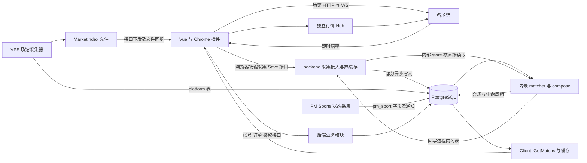

# changmen 架构审计与 A8 行为保护方案

**最新复核及改进：** 本轮复现首次账本接入的历史 SQL 数据重放后，已按用户要求把日常发布改成只读结构核验：不重放历史 SQL、不写账本，缺项明确失败，初始化只允许显式空库操作。测试账号不是生产账号。详见 [发布改进独立复核](./FINAL_RELEASE_REVIEW.md) 及其机器结果；此前验收保留为历史证据。

审计日期：2026 年 10 月 15 日。对象为当前工作区，基准提交 `1f9ca758959a24d947439bc42be6ae2ce5c3661e`，包含原有未提交文件。

后续第一阶段实施及本地验证见 [第一阶段验收](./PHASE1_LOCAL_ACCEPTANCE.md)。下文及原 evidence.json 保留审计时的发现。

matcher 依赖隔离与列表快照统一的实现、本地验证及范围限制见 [第二阶段验收](./PHASE2_LOCAL_ACCEPTANCE.md)。

实施后的 [本对话复核](./CONVERSATION_REVIEW.md) 已复现 5 个问题，包含第一阶段新增余额覆盖回归；应先修复，不能把既有测试通过当作无缺陷结论。

上述复核问题现已修复，最新实现及本地回归结果见 [复核修复验收](./REVIEW_FIXES_LOCAL_ACCEPTANCE.md)。

最新状态：[修复后第二次复核](./REVIEW_FIXES_SECOND_AUDIT.md) 的 3 个并发问题已修复。先补正式失败回归再改服务端；最新 7 项并发测试、共 43 项 PostgreSQL 场景及 14/14 全量任务结果见 [复核修复验收](./REVIEW_FIXES_LOCAL_ACCEPTANCE.md)。仅本地验证，未部署生产。

修复后的再次独立复核：补充 8 项 PostgreSQL 与 5 项快照缓存边界场景，连同原有回归共 51 项数据库/HTTP 和 5 项缓存场景通过；全量强制重跑 14/14 通过，覆盖范围内未发现新增业务回归。首次全量出现的既有 Cookie 测试 `bad port` 波动、复跑结果及验证限制均记录在 [验收记录首节](./REVIEW_FIXES_LOCAL_ACCEPTANCE.md)；本次未改业务实现。

发布检查曾发现 3 个业务文件不满足原 551 项保护，以及自动旧账号回填覆盖当前数据的风险；[改进前记录](./commit-push-deploy-readiness.json) 保留原证据。

上一轮改进：普通部署已取消历史账号导入/归属修复；只登记精确的账号持久化增量，原 551 清单和哈希保留，新增反篡改检查。该轮正式 `check:change` full 10/10 通过、551/551 通过，原有数据库/缓存回归及新增部署路径实测通过。该轮证据见 [本地验收历史记录](./REVIEW_FIXES_LOCAL_ACCEPTANCE.md) 和 [机器汇总](./deploy-safety-verification.json)；其后发现的首次账本重放风险及只读核验修复，以本页首节链接的最新独立复核为准。尚未 commit/push；`completeRelease=false` 保持，生产仍须 Actions 完整验收。本轮未操作生产。

结论：继续保留 Vue 客户端、Node 后端和 PostgreSQL，采用模块化单体演进。优先收拢持久化确认、迁移和缓存所有权，再减少模块循环依赖。新增服务、换数据库或继续搬目录，不能直接解决当前改动扩散的问题。

此次交付仅增加本目录的审计材料，没有修改运行代码、数据库、部署配置或 A8 保护规则。完整证据见 [evidence.json](./evidence.json)，可用 `node docs/audits/2026-10-15-architecture/audit.mjs` 重新生成。

## 审计范围与证据强度

检查了客户端启动与会话、采集、赔率、账号、投注、订单、PM/GTC 和体育边界，以及后端路由、鉴权集成、进程内缓存、RDS store、matcher、迁移、测试与发布规则。对高耦合链路和持久化路径做了源码核查，并运行现有检查和选定测试。

本报告是代码与架构审计；没有连接生产 RDS、执行迁移、重启生产进程或进行真实下注。没有生产查询计划、流量和资源曲线，因此不声称 RDS 已达到性能瓶颈，也不承诺具体延迟或成本收益。

证据分为源码确定事实、使用真实函数体和模拟依赖复现的故障，以及需要运行环境验证的风险推断。后文把已确认的失败传播问题与结构性风险分别说明。P1 表示应在架构重构前优先处理；P2 表示应纳入分阶段优化；P3 表示维护改进。它们不代表生产事故已经发生。

## 当前真实数据流



需要保留的正确分工：

- 浏览器传统场馆采集与 VPS 场馆采集并存，后者由 manifest 的 `vps_http_ws` 判定，不能重复写入。
- 前端通过 HTTP 使用后端业务能力，不直接连接 RDS。
- `Client_GetMatchs` 读取合场结果；合场、主客反转和结束生命周期不应移到浏览器。
- 场馆实时赔率可以直接更新前端 `oddsStore`，并非全部绕经 RDS。
- `client_matches` 的合场主体由 compose 写入；`pm_sport` 等附加字段还有独立更新方。因此应按字段和业务语义指定所有权，不能把“唯一合场算法”理解成“整张表只有一个写入方”。

对应源码：[采集接入](../../../server/backend/core/esport-api/store.js)、[合场调度](../../../server/match/matcher/ops/match_merge_once.js)、[PM 状态写入](../../../server/collectors/polymarket-sports/index.js)、[进程清单](../../../deploy/ecosystem.config.cjs)。

## 必须保护的 A8 行为

参考文件为 `A8/index0706.js`，当前本地 SHA256 为 `33b8a5e586f55564ac5483c723cc613b144726985daaa45c936d90fa038c4279`，与第二阶段及后续复核机器记录一致；此处校正初稿中的错误哈希。bundle 中压缩符号会随版本变化，审计以行为片段定位，不依赖文档中的 Io、fo 等别名。

| 保护项 | 已核实的依据与验收要求 |
| --- | --- |
| 账号数组线协议 | `[A8 可证实]` bundle 的 `B5="ACCOUNT"` 账号 store 通过 `getData(B5)` 加载，保存 `filter(accountId)` 后的整个 JSON 数组。保留现有 `Client_GetData`、`Client_SaveData` 形状及调用次数，不增加空列表或管理预览 skip。 |
| 账号刷新顺序 | `[A8 可证实]` 同一账号 store 的刷新循环逐账号调用 `updateBalance`、`updateOrders`，收尾包含取订单、保存账号及日志。架构拆分不能把这些 await、并行边界、异常处理顺序随意改掉。 |
| 采集开关语义 | `[A8 可证实]` bundle 的 `wp("collect"...)` 中，开关在上报函数内判断；SaveMatch 不额外用数组长度门控。保留现有常驻采集与上报门控的区分。 |
| Save 接口 | `[A8 可证实]` `saveMatchSource`、`saveBetSource`、`saveLiveTimer` 将数组 JSON 编码，并以 `provider`、`matchId` 等现有字段提交。保留 query 后缀、大小写及成功失败语义。 |
| OB 推送 | `[A8 可证实]` 所核查 bundle 的 OB message handler 处理 oddsUpdate、statusUpdate、suspended 三类消息。不能借清理订阅扩大业务处理范围。 |
| 投注与补单流程 | 保留仓库已有 FOK 历史源码及行为对比约束。历史 changmen 基线通过不等于全部 A8 行为已证明；对自动、手动、拒单、补单和双腿顺序仍应补齐 bundle 或抓包的回放证据。 |
| 后端存储实现 | `[changmen 推测]` A8 服务端落库方式不可见，不能用 A8 前端协议反推其必须采用何种数据库或缓存。changmen 的 players、订单、matcher 和持久化层可以在协议兼容下演进。 |
| 新增能力 | `[changmen 扩展]` 管理预览、预测市场扩展、PM/GTC、体育业务必须标明来源与适用范围；扩展不能改变传统路径缺省行为。 |

当前 `[A8 可证实]` 前端 ACCOUNT 保存仍不包含上述 skip；后端已有空覆盖、归属、场馆身份及 PF 余额保护。这些是需要保持的已有措施，不应在重构时删除。

## 优先级与主要发现

| 编号 | 级别 | 问题 | 主要影响 | 首选处理面 |
| --- | --- | --- | --- | --- |
| F01 | P1 | 统一建库脚本遗漏当前必需迁移 | 新环境字段缺失，发布与运行不一致 | 迁移执行器及隔离数据库验收 |
| F02 | P1 | 账号写入返回 0 后仍发布内存状态 | 保存结果可能与 RDS 不一致 | backend 与 db 的写入确认 |
| F03 | P1 | 账号整包保存与 prune 不在同一事务 | 半成功及并发状态冲突 | 后端账号事务边界 |
| F04 | P1 | 已有关键测试没有接入默认任务 | 正常检查通过不能覆盖核心数据层 | 测试任务接线 |
| F05 | P2 | profile 失败回滚覆盖后续成功写入 | 内存与数据库状态分离 | 每用户写入协调及缓存版本 |
| F06 | P2 | matcher 反向依赖 backend 内部 store | 合场、缓存、启动修改互相扩散 | 依赖注入与内部端口 |
| F07 | P2 | 前端循环依赖与扩展交织 | 局部改动需理解大量上下文 | 保持行为的外层隔离 |
| F08 | P2 | HTTP 契约尚未成为完整验收边界 | 字段变化需要跨端人工追踪 | A8 兼容契约与回放样本 |
| F09 | P2 | 列表缓存缺少一致的代次读取 | 旧数据可能标记为新快照 | 列表 repository 与刷新协调 |
| F10 | P2 | 采集异步写队列失败与停机闭环不足 | 上报接受后不一定形成可用 RDS 快照 | 有版本的快照写入协调 |
| F11 | P2 | 启动和健康判断未完整覆盖业务就绪 | 进程在线不代表列表链路可用 | readiness 与生命周期管理 |
| F12 | P2 | 共享包与验证规则扩大变更范围 | 单馆浏览器修改触发双端发布 | 依赖图驱动的发布范围 |
| F13 | P2 | DDL 分散于迁移和业务写路径 | 环境、权限与代码版本耦合 | 版本化 schema 管理 |
| F14 | P3 | 文档与代码的当前事实不一致 | 维护人员按过期模型做改动 | 精简现行入口及归档旧说明 |

### F01 统一建库脚本遗漏字段迁移

确定事实：[apply-rds-schema.mjs](../../../server/backend/scripts/apply-rds-schema.mjs:133) 从 033 跳到 035，从 038 跳到 040，没有执行 [034](../../../server/backend/db/migrations/034_platform_bets_market_id.sql) 与 [039](../../../server/backend/db/migrations/039_platform_bets_line_id.sql)。baseline 的 `platform_bets` 也不含这两个字段。

[platform_collector_store.js](../../../server/db/rds/platform_collector_store.js:321) 的 INSERT、UPDATE 和 SELECT 已使用 `market_id`、`line_id`。因此只按统一脚本初始化的环境不能满足当前代码。现有生产库是否由人工补过，需要单独只读核对。

处理：建立显式迁移清单与执行记录、checksum、迁移互斥；在临时 PostgreSQL 上验证从空库和上一版本升级两条路径。静态脚本还列出 002，但它是已弃用 no-op，应登记为历史排除，不能把所有遗漏项直接批量执行。

### F02 账号写入确认没有贯穿到 API

确定链路：

1. [batchSavePlayerAccountRecords](../../../server/db/rds/player_store.js:1225) 捕获普通 UPDATE 异常后返回 `0`；场馆账号唯一冲突会另外抛错。
2. [replaceAccountsForUser](../../../server/backend/core/db/store.js:205) await 后不检查更新行数，直接更新 `_accountsCache`。
3. [handleSaveAccounts](../../../server/backend/core/account/account_service.js:339) 可以继续 prune，最终返回成功。

本目录脚本使用真实 `replaceAccountsForUser` 函数体和返回 0 的模拟持久化依赖，已复现内存被更新。此复现不连接 RDS；实际 SQL 故障返回 0 的分支由源码确认。

处理：关键写失败必须抛出或返回明确失败；校验写入目标与实际更新结果，提交后再发布缓存。保持现有 API envelope，通过已有失败结果反馈，不要求前端增加保存门控。

### F03 账号保存与删除缺少统一事务

[handleSaveAccounts](../../../server/backend/core/account/account_service.js:280) 先校验与合并，再写账号并更新缓存，最后调用 `prunePlayersNotInList`。批量 UPDATE 和软删使用独立数据库调用；没有把整个保存动作包在一个事务内，prune 的结果也没有成为最终成功条件。

由此存在保存成功但 prune 失败、以及多个请求在校验与提交之间交错的风险。这里是可达的结构性风险，未在生产制造并发故障。

处理：将归属校验、关键保护字段合并、批量写入和 prune 组成同一事务；按用户协调并发，并在事务提交后发布内存快照。保留前端整包 ACCOUNT 保存及其时序。后端请求串行只能约束交错，不能自动识别另一个标签页提交的旧完整快照；这一冲突语义需专门设计，不能靠前端 skip 掩盖。

### F04 关键测试存在但默认任务不运行

`server/db/package.json` 没有 `scripts.test`，Turbo dry-run 中 `@changmen/db#test` 为 `<NONEXISTENT>`。因此 `npm test`、`test:backend` 的 Turbo 任务不会自行收集该包已有的 rds 测试。

[backend 的 test 命令](../../../server/backend/package.json:65) 是显式目录和文件白名单，没有包含 `core/account`、`core/db`。账号、订单相关测试文件虽存在，也不能据此认定在默认后端任务中执行。`npm run analyze:deps` 同样没有列入根 `test:checks`，导致边界检查通过而内部架构检查失败。

处理：接入适合各文件的测试执行器，区分 Vitest、`node --test` 和直接 Node assert 脚本，避免简单扩大 glob 后误报无 suite 或误跑需要外部环境的脚本。发布证据记录实际执行的测试清单与数量。先补接线，再把这些检查作为重构保障。

### F05 profile 的整行回滚可能撤销后续成功修改

[updateProfileSetting](../../../server/backend/core/db/store.js:90) 和 [setUserSetting](../../../server/backend/core/db/store.js:253) 先修改内存、await 数据库，失败时恢复之前的整行。

已用真实 `updateProfileSetting` 函数体复现：请求 A 保存未完成，请求 B 修改并成功，然后 A 失败，内存恢复到 A 之前的行，B 的成功修改也随之消失。复现只用了内存中的模拟依赖。

处理：在后端串行化同一用户的配置提交，或用代次检查阻止旧请求回滚新值；事务成功后统一发布缓存。若引入版本冲突策略，仍需保持现有配置线协议和前端调用顺序。

### F06 matcher 与 backend 的源码边界没有真正隔离

[match_merge_once.js](../../../server/match/matcher/ops/match_merge_once.js:3) 和 [rds_snapshot_cache.js](../../../server/match/matcher/ops/rds_snapshot_cache.js:2) 直接相对路径导入 backend 的 `db/store`、`esport-api/store`、`matcher_mode`。backend 又导入 matcher。这是源码层面的双向依赖，不要求 package.json 出现循环才构成耦合。

现有 `check:boundaries` 通过，因为 server-match 规则没有禁止这些反向导入。目录隔离已经存在，职责隔离尚未完成。

处理：由 backend 启动入口传入读取采集快照、读取上轮合场、提交后发布快照、回填源关联等端口。matcher 只依赖端口与数据对象；compose 算法、单写约束、结束语义、触发周期均保持。第一阶段继续内嵌执行，不增加进程。

### F07 前端大循环使扩展与主流程互相牵动

AST 分析排除测试与纯类型 import 后，仅静态运行时 import 就形成一个 **54 文件**强连通分量；加入可解析的字面量动态 import 后，最大分量为 **91 文件**。强连通意味着这些文件沿依赖边互相可达，不等于每次执行都产生循环初始化错误。图没有解析跨 workspace 依赖和运行时 bridge，不能当成全项目完整依赖图。

现有架构检查返回 5 条违规：domain/betting → stores/account；domain/polymarket → stores/betting、stores/odds；domain/predictfun → stores/odds；types → extensions/valueBet。其中有纯类型边，不能把 5 条全部描述成运行时循环。真实业务边可见 [PM 报价读取](../../../client/web/src/domain/polymarket/attachDetectionQuote.ts:4)、[accountPicker 引用](../../../client/web/src/domain/betting/describeArbPrepareSkip.ts:7)。

已有好的起点：`client-core` 的 API/odds bridge、venue bridge、adapter contract。应沿这些既有接口收拢职责，避免再新建一套通用框架。

处理：先把新增观察、展示、诊断扩展接到明确的外层端口；消息观察不应反向决定原投注流程。再逐个提纯无副作用的格式化和报价计算。保持 Pinia action、await 边界、失败提示、计次与补单规则。禁止通过把同步调用改成异步事件总线来“消环”。受保护文件暂不搬移或改写。

### F08 契约包还不足以独立保护跨端改动

确定事实：契约包已有 actions、DTO、Zod 和 URL 构造，方向正确；但 `test:api-contract` 当前只运行 URL 断言。[openapi.yaml](../../../packages/api-contract/openapi.yaml) 主要是路径索引，未定义完整请求体、响应与错误矩阵。SaveMatch 等 schema 只先验证外层 JSON 字符串；GetMatchs 出站校验有意宽松且 warn-only。

[action_registry](../../../server/backend/core/esport-api/action_registry.ts:45) 从同一 action 列表建立映射，再验证列表覆盖，主要证明分类索引完整，不能证明每个 action 的真实 handler 和返回语义均正确。

处理：按 ACCOUNT、GetMatchs、Save*、Order 分批建立表单请求、响应、空值、失败结果的回放样本。兼容层负责字段大小写、单位和历史别名，内部业务使用明确模型。先回放与 shadow 校验，再考虑收紧验证；不能直接用更严格 schema 拒绝 A8 当前会发的输入。

### F09 列表数据与版本标记分开读取

[loadClientMatchesFromDb](../../../server/backend/core/db/store.js:484) 先查列表，再独立获取 meta，随后用 meta 标记已加载的数据。在两次查询之间若发生合场提交，旧列表可能被标成新版本，后续 meta 相同则复用旧列表。下一轮内嵌合场更新或 90 秒兜底可以缩短这种状态，但不能证明读取原子一致。

另有维护成本：热命中仍需查 meta；空列表不满足 `_clientMatches.size` 条件，会继续走列表查询；多个请求缺少合并中的刷新 Promise。它们会增加查询数，但本次没有测量生产负载，不能据此声称数据库已经过载。

处理：将列表和代次作为一个一致快照读取，或从事务提交结果发布 `{generation, rows}`；只在快照完整时替换缓存。对并发刷新采用 single-flight，把“已加载的空列表”和“未加载”分开。继续保留远端 `pm_sport` 更新的失效通知或校验，不能只因 matcher 内嵌就取消所有外部版本检查。

### F10 异步快照写入缺少完整失败闭环

[common.js](../../../server/db/rds/common.js:71) 已具备同 key 合并、同 key 活跃写串行和队列上限，这是应保留的机制。剩余问题是满队列无法合并时丢弃本次写入；SQL 执行失败只写 warn；统计未提供完整的失败、重试与最后成功时间；[shutdown](../../../server/backend/server.js:269) 未显式停止 matcher 与排空写队列。

上报热缓存可以先成功，但 matcher 又以 RDS 中源记录的存在性为约束，因此持久化缺口可能表现成合场缺失。下一次采集通常可重建快照，不能把这种数据与不可丢失的订单混为一类。

处理：保持 SaveMatch/SaveBet 的现有接受语义，后端维护按 provider/match 区分的快照代次、最后落库状态、失败计数和有限重试；只重试仍为最新的快照，防止旧快照晚到覆盖新快照。停机采用有时限的停止调度、停止接收及排空流程。不要把订单、资金或当前 await 的 SaveLiveTimer 顺手改成异步写；后者还关联 debounce 合场时序。

### F11 在线检测与业务就绪需要分开

[server.js](../../../server/backend/server.js:250) 监听后异步拉取 profiles、恢复采集快照，并以已完成 Promise 启动 matcher。这样做有避免启动被全量 hydrate 拖住的既有原因，不能简单改成所有初始化全局串行等待。

[完整 health](../../../server/backend/http_routes.js:410) 面向本机或有权限的管理用户，已检查 DB 并提供池、Hub 与 API 时延信息；诊断接口也已有 matcher 和写队列信息。其成功主要由 DB 连接决定，未把 schema 能力、最近合场成功、快照年龄与初始化阶段组合为业务 readiness。外部公共 health 还有更轻的存活响应，使用时需明确是哪一种。

处理：保留轻量 liveness；新增或细化分能力 readiness，让登录、账号、采集、列表分别报告状态。启动入口统一管理资源及停止顺序。继续保持单 esport 实例，不能在缓存一致性和凭证共享问题解决前用 PM2 cluster 扩容。

### F12 局部代码变化被发布规则放大

[classify-deploy-scope](../../../scripts/deploy/classify-deploy-scope.mjs:67) 将整个 `packages/` 判为双端；[validation-plan](../../../scripts/verification/validation-plan.mjs:8) 将大量核心目录判为本地 full 验证。可复跑例子：

| 单文件修改 | 日常验证范围 | 发布组件范围 |
| --- | --- | --- |
| venue-adapter/ob/bet.ts | full | 前端和后端 |
| client/web/src/runtime/collectors.ts | full | 前端 |
| matcher/ops/match_merge_once.js | full | 后端 |
| server/db/rds/player_store.js | full | 后端 |

因此不能笼统说现在“所有改动都必须双端发布”；组件分发已有拆分，但包内边界仍较粗。registry 同时静态导入全部场馆，浏览器 adapter 与 Node loader/manifest 又共用包，进一步增加审查和构建影响面。

处理：先按浏览器实现、Node 基础设施、共享 manifest/契约建立消费图与保守范围规则。仅在证明后端不会加载某浏览器实现、打包工具也不依赖它之后，收窄发布组件。共享契约和 manifest 变动继续做跨端验证。保留部署基线读取、精确产物、不可跳过的 FOK 基线及后端先行顺序。

### F13 schema 生命周期分散

除 F01 的显式遗漏外，[pm_gtc_store](../../../server/db/rds/orderModes/gtc/pm_gtc_store.js:9) 仍在业务写入时 lazy CREATE TABLE/INDEX，另有 `server/db/schema` 和专项 apply 脚本。普通订单读取已尽量避免触发 GTC schema，这一点应继续保留。

处理：建立统一 schema 清单，声明每个模块所需版本与可选能力。先在部署中补齐显式迁移与能力检查，再保留一段兼容期的 lazy 兜底，确认旧环境升级后才移除业务 DDL。不要直接扫描所有 SQL 执行；其中有历史迁移、弃用脚本和执行前置条件。

### F14 文档不能继续充当多套当前真相

`docs/ARCHITECTURE.md` 当前仍列 Windows backend 3560，代码为 3700。`DATA_STORAGE.md` 的配置/账号 M→A 描述与当前 await 路径不一致；电竞结束迁移 history 的概括也与当前 `ended_at` 保留行模型不同，体育表的读写说明在不同章节有差异。AGENTS 的早期“只在客户端采集”概括，需要与末尾 VPS 场馆清单一起读。

处理：保留一个当前拓扑入口、一个数据所有权表、一个变更影响表；其余迁移过程文档标明历史状态。事实从 package scripts、manifest、进程清单、迁移能力清单和可运行检查生成或校验，避免再写一套独立维护的巨型架构说明。

## 目标职责划分

以下是职责界面，不要求创建新包、服务或搬目录。

| 模块 | 负责 | 对外稳定边界 |
| --- | --- | --- |
| A8 兼容客户端行为 | 既有 store/action、采集、下注、拒单与补单的可观察行为 | 现有方法、HTTP 请求与执行时序 |
| 客户端 runtime | 安装已有 bridges、会话和资源生命周期 | 明确的启动停止及读写端口 |
| 场馆 adapter | 场馆协议、报价、签单、提交和场馆事实解释 | 既有 adapter/provider contract |
| A8 HTTP 兼容层 | 表单解析、字段和响应转换、权限接入 | 原有 Client/API actions 与 envelope |
| 后端业务模块 | 账号、订单、鉴权、配置、采集接入 | 按业务命名的命令与查询 |
| matcher | 合场算法、绑定与结束生命周期 | 快照输入和提交输出 |
| repository 与事务 | 各领域持久化、并发控制、提交后缓存发布 | 显式成功失败和一致快照 |
| PostgreSQL | 账号、订单、配置、采集快照与合场持久化 | 版本化 schema 与领域事务 |

关键数据应分别规定所有者，而不是给所有 Map 再套一层泛化缓存：

| 数据 | 真相与写入职责 | 缓存规则 |
| --- | --- | --- |
| 账号 | players；后端账号事务 | 提交成功后发布；读失败不当空覆盖 |
| 配置 | profiles；每用户配置提交 | 带代次发布，旧请求不能回滚新值 |
| 订单和资金 | orders、football_orders 及对应领域事务 | 必须持久化确认；保留体育隔离 |
| GTC 执行状态 | pm_gtc_executions；GTC 授权与状态模块 | 不重新建立第二套首单套利编排或公共财务真相 |
| 场馆采集快照 | 每 provider 的 browser 或 VPS 单一来源 | 允许有界异步；记录接受与落库代次 |
| 合场身份和生命周期 | compose；人工维护走明确命令 | 同代次整体发布，不能从读路径重新合场 |
| PM 状态附加字段 | PM Sports 状态写入方 | 合场发布不能覆盖更新字段，保留独立 revision |
| 实时赔率 | 客户端场馆行情；oddsStore | 保留 HTTP 初始值、WS 增量、锁消息竞态处理 |
| 凭证与 MarketIndex 文件 | 现有 storage 与指定 collector | 显式进程归属和原子发布；不假设多实例共享 |

## 实施顺序与验收

### 第一阶段 建立可靠的修改基线

先接入 F04 漏跑的测试，再修 F01 迁移遗漏、F02 写入确认和 F03 事务边界。修复 F05 的并发回滚；补充与这些缺陷对应的故障注入测试。

验收：空库初始化与旧库升级都满足字段要求；写失败不返回成功、不发布新缓存、不执行部分 prune；并发配置失败不覆盖后续成功值；原有 ACCOUNT 请求及调用顺序不变。

本阶段主要改后端、DB 和检查接线，可获得最大的确定收益。触及已有精确保护文件前先盘点约束，避免以修改快照或降低检查强度来换取通过。

### 第二阶段 隔离 matcher 与列表缓存

为 F06 定义最小端口，由 backend 注入，逐个移除 matcher 对 backend 的源码导入。统一 F09 的快照代次与刷新协调，再完善 F10、F11 的失败状态和停机流程。

验收：相同 snapshot 的合场输出、ID、主客反转、结束标记与旧实现一致；保留单写保护及 timer debounce；matcher 的业务实现不再导入 backend store；重启、写队列失败和外部 PM 状态更新可解释。

涉及写入的对比只运行一份真实写路径。新旧逻辑差分限于纯计算、只读或明确禁写的 shadow 模式；不能双跑下单、保存订单或合场写库。

### 第三阶段 补齐兼容契约并缩小发布影响

把 A8 行为样本与当前 API 样本组成契约测试，作为 F08 的跨端边界；再根据真实消费图优化 F12。统一 F13 的 schema 版本能力。

验收：只改浏览器场馆实现时可证明是否需要后端重启；共享 manifest 或契约改变时仍执行集成验证；新旧前后端组合的兼容情况有明确结果。schema 采用先增后退的升级方式，避免代码回滚后数据库立即不兼容。

### 第四阶段 渐进减少前端循环

先处理未受精确冻结约束的外围模块和新增扩展；新依赖不得扩大现有强连通分量。再在有行为回放证据的前提下，逐个改纯计算或端口，不集中重写 betting/account/message store。

验收不能只看 TypeScript 通过或代码更短。需要比较请求序列、参数、调用次数、await 与并行关系、假时钟下的定时、成功失败提示、计次和补单结果。现有精确源码保护继续运行；受保护核心的结构变化如无法被原规则证明，应暂缓该项，并独立设计可评审的等价证明，不能覆盖原始基线。

## 暂缓的架构动作

- 当前不拆微服务、双仓库或更多共享基础包；先证明模块边界能在单进程内成立。
- 当前不换 RDS，也不增加 Redis、Kafka 作为默认解法。只有测量证实跨进程状态或持续负载需要时再评估。
- 不把传统浏览器采集和下注搬到服务器，不把数据库表结构暴露给 A8 客户端。
- 不通过减少账号保存调用、改变采集开关用途、增加前端空值门控或改变拒单补单等待时间来优化性能。
- 不复制一套 GTC 首单业务编排或第二套公共订单账本；模式特有参数和场馆行为留在 adapter，公共业务复用原职责。
- 不直接移除现有缓存、历史兼容或 lazy schema；先提供一致性与环境升级替代路径。

## 已执行验证及限制

| 检查 | 结果 | 能证明的范围 |
| --- | --- | --- |
| `npm run check:boundaries` | 通过 | 现有团队边界规则通过，不能覆盖 matcher 反向依赖 |
| `npm run analyze:deps` | 失败，5 条违规 | 当前前端分层基线存在问题 |
| `npm run typecheck:frontend` | 通过，执行 vue-tsc | 当前前端类型检查通过 |
| `npm run check:fok-parity` | 通过 | 包含 40 个核心文件、29 个 PM 函数体、18 个执行场景；后续输出含 180 次对比、20 个确认故障场景、45 个原门控场景及 GTC 隔离检查 |
| 选取的客户端测试 | 21 文件、187 测试通过 | collect、odds、账号、主循环、A8 round 及部分双腿阶段 |
| 选取的服务端与 DB 测试 | 6 文件、27 测试通过 | 写队列、player SQL、合场生命周期、snapshot、路由注册 |
| `npm run test:api-contract` | 通过 | URL 构造断言，不是完整 HTTP 契约 |
| `npm run test:ob --workspace=@changmen/web` | 离线合成及 provider 检查通过 | 脚本内置 live 登录分支失败并跳过，TJ01 文件缺失跳过；不能称为线上端到端通过 |
| 本目录 `audit.mjs` | 通过并生成 evidence.json | AST 依赖图、迁移清单对比、发布范围例子及两项缓存故障复现 |
| Turbo test dry-run | 已检查 | DB test task 不存在；未把 dry-run 当测试执行 |

本次未运行完整 `npm test`、生产构建、完整发布验收或真实场馆端到端。FOK 检查输出的 `fullReleaseAccepted` 仍为 false；通过审计选定检查不等于具备发布许可。

### 复跑关键检查

```powershell
node docs/audits/2026-10-15-architecture/audit.mjs
npm run check:boundaries
npm run analyze:deps
npm run typecheck:frontend
npm run check:fok-parity
npm run test:api-contract
```

已执行的选定测试命令：

```powershell
npm exec --workspace=@changmen/web -- vitest run src/stores/collectStore.test.ts src/stores/oddsStore.a8.test.ts src/stores/account src/stores/match/mainBetLoop.test.ts src/stores/betting/a8/runA8ArbRound.test.ts src/stores/betting/autoBet/phases/settleBothArbLegs.test.ts src/stores/betting/autoBet/phases/placeArbLegs.test.ts src/stores/betting/autoBet/phases/checkArbLegs.test.ts
npm exec -- vitest run server/db/rds/write_queue.test.mjs server/db/rds/player_store.test.mjs server/db/rds/client_matches_lifecycle.test.mjs server/match/matcher/ops/rds_snapshot_cache.test.mjs server/match/matcher/tests/snapshot_contract.test.mjs server/backend/core/esport-api/action_registry.test.mjs
```

落地后的效果以变更影响面衡量：matcher 不再导入 backend 内部 store；写失败不会形成成功缓存；关键测试实际执行；单馆浏览器变动的发布范围有依赖证据；前端循环不再扩大并逐步缩小。A8 可观察行为保持，是每一步的独立验收条件。
